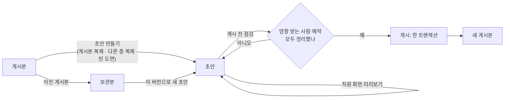
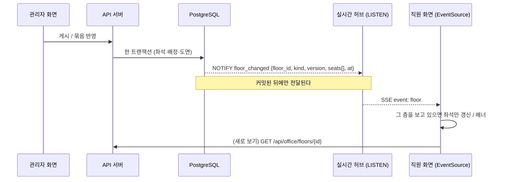
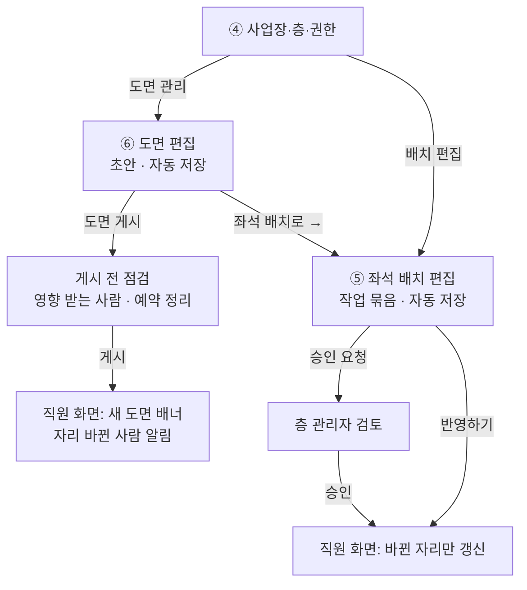

# 도면 편집 · 좌석 배치 편집 설계 (v0.7 · 6단계까지 반영)

관리자 페이지의 두 핵심 기능, **⑥ 도면 편집**과 **⑤ 좌석 배치 편집**을 어떻게 만들지 정리한 문서입니다.
디자인 시안(Claude Design의 Admin·FloorEditor 화면)과 지금 DB 구조(`db/schema/03_space.sql`, `04_seating.sql`)를
바탕으로 했고, 아래 네 질문에 답하는 것을 목표로 합니다.

1. 도면을 고치면, 이미 앉아 있던 사람들은 어떻게 되나
2. 입주 부서·팀(팀 구역)은 어떻게 만들고 고치고 없애나
3. 고친 도면·배치를 보고 있는 직원 화면에는 어떻게 보여 주나
4. 도면과 배치는 어디에 어떻게 저장해서 오래 유지하나

맨 끝 [정한 것](#11-정한-것)에 결정 사항을 모았습니다. v0.2는 그 결정을 본문에 반영했고,
1단계(좌석 배치 편집)는 [4.4](#44-1단계에서-만든-것), 2단계(팀 구역 관리)는 [5.4](#54-2단계에서-만든-것),
3단계(도면 편집기)는 [3.4](#34-3단계에서-만든-것), 4단계(일정과 이사)는 [3.5](#35-4단계에서-만든-것),
5단계(도면 편집기 다듬기)는 [3.6](#36-5단계-도면-편집기-다듬기-사용자-요청-8가지),
6단계(도면 파일로 초안 만들기)는 [3.7](#37-6단계-도면-파일로-초안-만들기)처럼 만들었습니다.

---

## 0. 한눈에

| | ⑥ 도면 편집 | ⑤ 좌석 배치 편집 |
|---|---|---|
| 무엇을 고치나 | 벽·기둥·공간(회의실 등)·책상 묶음 | 누가 어느 자리에 앉나, 팀 구역, 좌석 유형 |
| 얼마나 자주 | 드묾 (이사·리모델링) | 잦음 (입사·퇴사·조직 개편) |
| 저장 단위 | **초안 → 게시** (도면 버전) | **작업 묶음** (여러 변경을 모아 한 번에 반영) |
| 직원 화면 반영 | 게시하는 순간 한 번에 | 묶음을 반영(또는 승인)하는 순간, 바뀐 자리만 |
| 누가 | 층 관리자 이상 (그 층) | 층 관리자 이상(층 전체), 구역 관리자(내 구역, 즉시 또는 승인 후) |

핵심 원칙 다섯 가지:

1. **좌석은 도면 버전이 아니라 층에 붙은, 오래 가는 행이다.** 도면의 책상 칸마다 고유 ID가 있고
   (`seats.plan_element_key`), 그 ID로 좌석과 연결한다. 그래서 도면을 새 버전으로 고쳐도 같은 책상이면 같은 좌석,
   같은 배정이 그대로 이어진다. (지금 스키마가 이미 이렇게 되어 있다.)
2. **게시할 때 "영향 받는 사람"을 반드시 보여 준다.** 자리가 없어지는 사람은 기본이 "미배치"이고, 관리자가 원하면
   그 자리에서 새 자리를 고른다. 점검 화면에 이름이 모두 나오므로 아무도 모르게 자리를 잃는 사람이 없다.
3. **팀 구역의 원본은 "좌석 묶음"이다.** 구역 모양은 그 좌석들을 감싸서 자동으로 그린다. 책상이 움직여도 구역이 따라간다.
4. **직원 화면은 바뀐 만큼만, 놀라지 않게 바뀐다.** 자리 배정은 바로 다시 읽고 짧은 안내("7F 자리 배치가
   바뀌었어요"), 도면 게시는 배너 "새 도면이 게시됐어요"를 띄우고 **5초 뒤 저절로 새로 읽는다**. 내 자리가 바뀐
   사람에게는 따로 알린다.
5. **한 번에, 되돌릴 수 있게 저장한다.** 게시·반영은 한 DB 트랜잭션, 도면은 버전마다 통째로 보관, 배정은 끝내고 새로
   만드는 이력 방식(5년 보관). 언제든 "이 버전으로 되돌리기"가 된다.

---

## 1. 용어

| 용어 | 뜻 |
|---|---|
| 도면 (floor plan) | 한 층의 그림. 버전이 있다: 초안(DRAFT, 층마다 1개), 게시본(PUBLISHED, 1개), 보관본(ARCHIVED, 여러 개) |
| 요소 (element) | 도면을 이루는 것: 벽, 기둥, 문, 창, 계단·EV, 공간(사무·회의실·탕비·화장실·임원실·출입 불가), 책상 묶음, 가구, 라벨 |
| 책상 묶음 · 칸 | "마주보기 2×3" 같은 책상 덩어리. 칸마다 책상 또는 빈칸. **책상 칸 1개 = 좌석 1석** (디자인: "책상 = 좌석") |
| 좌석 (seat) | 직원이 배정받는 자리. 고정석 / 팀 내 자율석 / 사용 중지 |
| 팀 구역 (zone) | 한 팀(부서)이 쓰는 좌석 묶음 + 색. 공용 자율석 구역은 부서 없음 |
| 배정 (assignment) | 누가 어느 좌석에 언제부터 언제까지 앉나 |
| 미배치 인원 | 팀원인데 지금 자리가 없는 사람 (신규 입사, 복귀, 도면 변경으로 자리가 없어진 사람) |
| 작업 묶음 (change set) | 배치 화면에서 한 변경들을 모은 것. 자동 저장되고, 한 번에 반영하거나 승인 요청한다 (`change_requests`) |

---

## 2. 데이터 모델

### 2.1 지금 있는 것과 바꿀 것

| 테이블 | 지금 | 바꾸거나 더할 것 |
|---|---|---|
| `floor_plans` | 층별 버전, DRAFT/PUBLISHED/ARCHIVED, `geometry` JSONB, 배경 파일, 층당 게시본 1·초안 1 (부분 유니크 인덱스) | `base_plan_id`(초안이 어느 게시본에서 시작했나), `revision`(자동 저장마다 +1, 동시 수정 막기), `editing_by`·`editing_heartbeat_at`(편집 중 표시), `publish_note`, `scheduled_publish_at`(4단계). 배경 파일 칸은 남겨 두되 1차 편집기는 쓰지 않는다 (결정 8). 6단계에서 밑그림은 버전이 아니라 층에 붙인 `floor_plan_backgrounds`로 따로 둔다 (3.7) |
| `seats` | 층에 붙음, `plan_element_key`(책상 칸 ID), `zone_id`, 좌표(비율), `status`에 REMOVED | `removed_at`, `removed_by_plan_id`(어느 게시로 빠졌나) |
| `zones` | 층별 구역, 부서, 색, `shape` | `shape`는 **좌석에서 자동 계산한 캐시**로 바꾼다 (`shape_mode`: AUTO/MANUAL). `name`은 기본이 부서 이름(별칭 허용) |
| `meeting_rooms` | `plan_element_key`(공간 ID), `shape` | 게시할 때 도면의 회의실 공간과 맞춘다 |
| `seat_assignments` | 기간 있는 배정 이력, 좌석·사람 겹침 금지(EXCLUDE) | **(1단계)** `source`(MANUAL / CHANGE_SET / PLAN_PUBLISH / ORG_CHANGE), `ended_by_request_id`(어느 묶음이 끝냈나: 예정 취소 때 되살린다). `change_request_id`는 이미 있음 |
| `change_requests` · `_items` | 구역 관리자 요청(DRAFT/PENDING/APPROVED/REJECTED), 항목 ASSIGN/UNASSIGN/MOVE_ZONE | **(1단계)** 층 관리자의 작업 묶음도 같은 테이블에 (바로 반영하면 스스로 APPROVED). 항목에 `SET_TYPE`+`seat_mode`, `expected_employee_id`(만들 때의 상태, 충돌 감지), 묶음에 `effective_at`(언제부터). 자리 교환은 ASSIGN 2건 |
| `audit_logs` | 있음 | PLAN_PUBLISH, CHANGE_SET_APPLY, ZONE_* 기록 |
| `notifications` | 있음 (IN_APP) | SEAT_CHANGED(내 자리 바뀜), PLAN_PUBLISHED(관리자) |

새 테이블은 만들지 않는 것을 목표로 한다. 필요한 칸을 더하는 정도로 끝난다.

### 2.2 도면 geometry (JSON v1)

목업 게시본(v0)은 `{walls, pillars, spaces}`를 비율(0~1) 좌표로 갖고 있다. 편집기는 **미터 단위** v1을 쓴다
(격자 0.5 m, 축척 맞춤이 쉬움). 직원 화면 API는 지금처럼 비율로 바꿔서 내보낸다(`server/app/plan_geometry.py`의 `to_ratio`).
읽을 때 `schema` 번호를 보고 변환하고, v0 도면은 편집기에서 처음 열 때 v1로 바꾼다(`from_v0`: 구역마다 좌석을 책상 묶음으로 맞춘다).

```json
{
  "schema": 1,
  "grid_m": 0.5,
  "desk": { "w": 2.665, "h": 1.668 },
  "elements": [
    { "id": "wall-1", "type": "wall", "x": 1.5, "y": 1.5, "w": 47.0, "h": 27.0 },
    { "id": "wall_line-2", "type": "wall_line", "x": 30, "y": 20, "x2": 36, "y2": 20, "line_w": 0.2 },
    { "id": "entrance-1", "type": "entrance", "label": "", "main": true, "x": 22, "y": 28.2, "w": 3, "h": 0.6 },
    { "id": "pillar-3", "type": "pillar", "x": 12.75, "y": 9.6, "w": 0.75, "h": 0.75 },
    { "id": "space-2", "type": "space", "kind": "pantry", "label": "", "x": 28.5, "y": 2.1, "w": 6.0, "h": 6.4 },
    { "id": "room-11", "type": "room", "name": "소회의실 702", "capacity": 6, "equipment": ["TV"],
      "x": 12.9, "y": 2.1, "w": 6.2, "h": 6.4, "line_w": 0.2, "label_size": 120, "label_bold": true },
    { "id": "desks-b", "type": "desk_group", "layout": "face", "rows": 6, "cols": 3, "x": 15.6, "y": 12.6,
      "rotation": 90, "desk_w": 2.4, "desk_h": 1.4,
      "cells": [
        { "id": "seat-7", "desk": true, "code": "B-01", "flip": true },
        { "id": "seat-8", "desk": true, "code": "B-02" },
        { "id": "desks-b.3", "desk": false, "code": "" }
      ] }
  ]
}
```

- **요소는 사각형과 선** (결정 8, 선 벽은 5단계에서 더함). 벽은 사각형의 테두리(바깥 벽은 큰 사각형 하나)이거나 선 벽
  (`wall_line`, 양 끝점과 굵기)이다. 출입구(`entrance`)는 벽 위에 놓는 사각형이고 `main`이면 주 출입구다.
- **모양**: 벽·선 벽·공간·회의실·출입구는 `line_w`(선 굵기 m), 공간·회의실·출입구는 `label_size`(글자 %)·`label_bold`.
  없으면 기본 모양. 직원 화면에는 선 굵기를 도면 폭 대비 비율로 보낸다(`to_ratio`).
- **책상 묶음**: `layout`이 `face`면 두 줄씩 마주 앉고, `one`이면 모두 같은 쪽을 본다. 칸은 줄 순서로 `rows × cols`개이고
  칸 하나가 좌석 하나다(`desk: false`는 빈칸). 책상 하나 크기는 `desk_w`·`desk_h`(m, 없으면 2.665 × 1.668), 간격은 정해져 있다.
  `rotation`(0·90·180·270)은 묶음을 통째로 돌린다(90 = 의자가 아래였던 것이 오른쪽으로; 돌려도 `(x, y)`는 묶음이 차지하는
  사각형의 왼쪽 위). 칸의 `flip`은 그 책상만 반대로 앉는다. 좌석의 의자 방향 = 기본 방향 + `rotation` + (`flip`이면 180).
  게시하면 좌석의 위치·의자 방향·크기(`seats.w`·`h`, 도면 대비 비율)가 맞춰진다. 도면의 `desk`는 새 책상 기본 크기다.
- 요소 `id`·칸 `id`는 편집기가 만들 때 한 번 정하고 바뀌지 않는다. 복제하면 새 ID.
- 책상 칸 → 좌석 (`seats.plan_element_key = cell.id`), 회의실 → 회의실 (`meeting_rooms.plan_element_key = room.id`).
  목업 좌석·회의실은 처음 변환할 때 `seat-<좌석 id>`, `room-<회의실 id>`로 이어 둔다.
- 공간 종류: `core`(코어·EV·계단) `pantry` `restroom` `lounge` `storage`(창고·포커스룸) `service`(설비·복합기) `restricted`.
- **팀 구역은 도면에 넣지 않는다.** 디자인에서도 레이어 "팀 구역 · 배치 화면에서"로 되어 있다. 구역은 좌석 배치 화면 몫이다.
- 크기: 한 층 요소 수백 개, 수십~수백 KB. 자동 저장 때 통째로 저장해도 충분하다. 서버는 요소 2,000개, 묶음 줄·칸 20까지 받는다.

### 2.3 도면과 행을 맞추는 규칙 (게시할 때)

```
게시본 도면의 책상 칸  ─┐                      ┌─ seats (살아 있는 좌석)
                       ├─ cell.id = plan_element_key ─┤
초안 도면의 책상 칸   ─┘                      └─ seat_assignments (누가 앉았나)
```

| 초안에서 | 좌석 | 앉아 있던 사람 |
|---|---|---|
| 같은 칸, 위치·방향만 바뀜 | 같은 좌석, 좌표·방향만 갱신 | 그대로 |
| 같은 칸, 좌석 번호만 바뀜 (B-03 → B-05) | 번호 갱신 | 그대로, "좌석 번호가 바뀌었어요" 알림 |
| 새 책상 칸 | 새 좌석 (빈 자리) | — |
| 책상 칸이 없어짐 (지움, 빈칸으로 바꿈) | `REMOVED` (지우지 않음) | **정리 필요** (3.2) |
| 책상 묶음을 지우고 새로 그림 (ID가 바뀜) | 옛 좌석 REMOVED + 새 좌석 | 게시 전 점검에서 "같은 자리로 이어 붙이기" 추천 (번호가 같거나 위치가 가까운 새 칸) |
| 회의실 공간이 없어짐 | 회의실 비활성 | 앞으로 잡힌 예약 **정리 필요** (3.2) |

---

## 3. 도면 편집 (⑥)

### 3.1 초안의 일생



- **만들기**: 기본은 지금 게시본을 복제해서 고친다. 새 층은 빈 도면에서 시작한다.
- **그리기는 사각형만** (결정 8): 벽(가늘고 긴 사각형)·기둥·공간·책상 묶음을 모두 격자(0.5 m)에 맞춘 사각형으로 그린다.
  PDF 평면도를 배경으로 깔고 따라 그리는 기능은 넣지 않는다. 실제 평면도와 똑같을 필요는 없고, 직원이 "어디쯤"인지
  알아볼 정도면 된다.
- **자동 저장**: 고치고 1.5초 쉬면 저장. 요청에 `revision`을 같이 보내고, 서버의 값과 다르면(다른 탭·다른 사람이 먼저 저장)
  409로 막고 "다른 곳에서 고쳤어요 · 다시 불러오기"를 띄운다. 헤더에 "초안 · 2분 전 자동 저장 · 게시 전까지 직원 화면에
  반영되지 않음"(디자인 문구).
- **동시 편집**: 한 층 초안은 한 사람이 편집한다. 편집 화면이 30초마다 heartbeat를 보내고, 다른 관리자가 열면
  "강지아 차장이 편집 중 (1분 전)" + 보기만. 2분 넘게 heartbeat가 없으면 풀리고, 상위 관리자는 "편집 넘겨받기".
- **되돌리기·다시하기**: 편집 화면 안에서 명령 단위로 (서버는 자동 저장 스냅샷만 안다).
- **미리보기**: 초안 도면 + 지금 배정으로 직원 화면 모양을 그대로 보여 준다.
- **보관본으로 되돌리기**: 보관본에서 새 초안을 만들어 게시한다. 게시 전 점검을 똑같이 거친다(그사이 배정이 바뀌었을 수 있다).

### 3.2 게시 전 점검: 기존 배치 인원은 어떻게 하나 (질문 1)

"도면 게시"를 누르면 바로 게시하지 않고, 초안과 지금 상태를 비교한 **점검 화면**을 먼저 띄운다.

```
7F 도면 게시 전 확인
────────────────────────────────────────────
✓ 좌석 46석 → 48석 (새 좌석 4, 없어지는 좌석 2, 번호 바뀜 3)
! 자리가 없어지는 사람 2명 · 기본은 미배치             [모두 추천 자리로]
   조시우 대리 (재무팀)  B-04 →  미배치   [추천: B-11 같은 구역 빈 자리] [직접 고르기]
   오서연 과장 (재무팀)  B-05 →  미배치   [추천: B-12] [직접 고르기]
! 예약이 있는 회의실이 없어짐 1곳
   소회의실 702 · 앞으로 예약 3건 → [회의실 703으로 옮기기 ▾] [취소하고 알리기]
· 구역 밖으로 나간 좌석 1석 (D-07: 재무팀 구역 → 구역 없음)   [배치 화면에서 정리]
────────────────────────────────────────────
게시 메모: [7F 리모델링 1차]            반영: (•) 지금  ( ) 날짜 지정
                                   [취소]  [게시하기]  ← 빨간 항목을 모두 정해야 켜짐
```

- **자리가 없어지는 사람은 기본이 미배치** (결정 2). 그 팀의 "미배치 인원" 목록으로 가고, 나중에 좌석 배치 화면에서
  배정한다. 게시 전에 바로 자리를 정하고 싶으면 사람마다 고른다.
  1. **추천 자리로 옮기기**: 같은 구역의 빈 고정석 → 같은 번호의 새 좌석 → 가장 가까운 빈 자리 순으로 자동 추천.
     "모두 추천 자리로"로 한 번에.
  2. **직접 고르기**: 초안 도면 위에서 고른다.
- **오늘 자율석을 쓰는 사람**(DAILY)의 좌석이 없어지면 그 사용을 끝내고 알린다.
- **회의실이 없어지거나 정원이 줄어드는데 앞으로 예약이 있으면** 다른 회의실로 옮기거나(같은 시간 빈 곳 추천)
  취소하고 참석자에게 알린다.
- 미배치가 기본이라 게시 버튼은 바로 누를 수 있다. 대신 "2명이 미배치로 가요"를 버튼 옆에 크게 보여 주고, 게시하면
  그 사람들에게 알림이 간다. 예약이 걸린 회의실은 정해야 게시된다 (예약을 말없이 지우지 않는다).

**게시는 한 트랜잭션**으로 처리한다. 중간에 실패하면 전부 취소된다.

1. 이 층 게시본·초안 행을 잠근다 (`SELECT … FOR UPDATE`). 초안의 `base_plan_id`가 지금 게시본이 아니면
   (그사이 다른 게시가 있었으면) 멈추고 점검을 다시 하게 한다.
2. 이전 게시본 → ARCHIVED, 초안 → PUBLISHED (`published_by/at`, 메모).
3. 좌석 맞추기 (2.3 표): 좌표·번호 갱신, 새 좌석 INSERT, 없어진 좌석 REMOVED.
4. 점검에서 정한 대로 배정 옮기기: 옛 배정 `ends_at = now()`, 새 배정 INSERT (`source = PLAN_PUBLISH`).
   미배치로 정한 사람은 끝내기만. 좌석·사람 겹침은 DB 제약(EXCLUDE)이 마지막으로 막는다.
5. 회의실 맞추기, 예약 옮기기·취소.
6. 구역 모양 다시 계산 (좌석이 움직였으니).
7. `audit_logs`(바뀐 좌석·사람 요약), `notifications`(자리 바뀐 사람에게), `NOTIFY floor_changed`.

### 3.3 권한

| | 전사 | 사업장 | 층 | 구역 |
|---|---|---|---|---|
| 도면 초안 편집·게시 | ○ | ○ (그 사업장) | ○ (그 층) | ✕ |
| 보관본 되돌리기 | ○ | ○ | ○ (그 층) | ✕ |
| 층 추가·삭제 | ○ | ○ (그 사업장) | ✕ | ✕ |

결정 1: 도면 수정은 **층 관리자 이상**. 시안의 "좌석 추가 · 도면 수정 = 층 관리자 이상"과 같다.
구역 관리자는 도면을 보기만 한다.

### 3.4 3단계에서 만든 것

| 영역 | 내용 |
|---|---|
| DB (`03_space.sql`) | `floor_plans`에 `revision`(자동 저장 비교), `base_plan_id`, `publish_note`, `editing_by`·`editing_heartbeat_at`(편집 잠금). 좌석 번호 유일은 살아 있는 좌석끼리만(빠진 좌석 번호를 다시 쓸 수 있게), `seats.removed_at`·`removed_by_plan_id`, 층 안 책상 칸 키 유일. 회의실 이름 유일도 살아 있는 회의실끼리만(`06_rooms.sql`) |
| 도면 모양 (`server/app/plan_geometry.py`, `frontend/src/lib/planGeometry.ts`) | v1 검사(`validate`), 게시를 막는 문제(`problems`: 번호 없는 책상·같은 좌석 번호·이름 없는/같은 이름 회의실·도면 밖), 책상 칸 위치 계산, v0→v1 변환, 직원 화면용 비율 변환 |
| API (`routers/plans.py`) | 편집할 수 있는 층, 편집 화면 데이터(초안·게시본·보관본·지금 앉은 사람과 예약), 초안 만들기(게시본·빈 도면·보관본·다른 층 복제), 자동 저장(409 REVISION · 423 EDITING · 422 BAD_GEOMETRY), 편집 표시·넘겨받기, 초안 버리기, 게시 전 점검, 게시 |
| 편집 화면 (`/admin/plans`) | 시작 화면(어디서 시작할지 고르기, 게시 기록), 그리기 도구(벽·기둥·회의실·공간 7종·책상 묶음 4종), 고르기·끌어서 옮기기·손잡이로 크기 바꾸기, 0.5 m 칸 맞추기, 확대·축소, 속성 칸(위치·크기, 공간 종류·이름표, 회의실 이름·정원·장비, 책상 묶음 모양·줄·칸·칸별 책상·번호, 번호 다시 매기기), 되돌리기·다시 하기, 단축키, 자동 저장, 편집 잠금 띠·넘겨받기, 저장 충돌 띠, 게시 점검 대화상자 |
| 관리자 첫 화면·메뉴 | "도면 관리" 버튼과 왼쪽 메뉴 "도면 편집"이 이 화면으로 간다 (층 관리자 이상) |
| 직원 화면 | 게시 배너가 뜬 5초 동안 그 층 좌석 알림으로 따로 새로 읽지 않는다(게시 한 번에 좌석 알림이 여러 개 온다) |

3단계에서 정한 세부 규칙:

- **초안 만들기**: 게시본에서(기본, 책상·회의실이 지금 좌석·예약과 이어진 채로), 빈 도면(바깥 벽만), 다른 층 게시본 복제
  (모양만, 지금 좌석과는 이어지지 않음), 보관본에서 다시 시작. 층마다 초안은 하나.
- **편집 잠금**: 편집 화면이 30초마다 편집 중 표시를 보낸다. 다른 관리자가 열면 "○○ 님이 편집 중" 띠와 함께 보기만 하고
  15초마다 다시 읽는다. 2분 넘게 표시가 없거나 "편집 넘겨받기"를 누르면 넘어간다. 넘겨받기는 감사 기록에 남고, 원래 편집하던
  화면은 다음 저장 때 423을 받아 보기 전용으로 바뀐다.
- **저장 충돌**: 409면 "다른 화면에서 먼저 저장" 띠를 띄우고 "저장된 초안 다시 불러오기" 또는 "내 것으로 덮어쓰기"를 고른다.
- **지울 때 알림**: 앉은 사람이 있는 책상, 예약이 남은 회의실을 지우면 바로 알려 준다("게시할 때 새 자리를 고를 수 있어요"). 되돌리기로 살릴 수 있다.
- **새 책상의 구역**: 게시할 때 같은 묶음의 좌석 중 가장 많은 구역·유형을 따른다. 모두 새 책상이면 구역 없음(배치 화면에서 묶는다).
- **추천 자리**: 같은 구역의 빈 고정석 중 가장 가까운 곳 → 새 책상. 한 자리를 두 사람에게 추천하지 않는다.
- **회의실**: 이름·정원을 바꿔도 같은 회의실이라 예약이 이어진다. 예약이 남은 회의실을 지우면 게시 점검에서 다른 회의실로 옮기거나
  취소를 골라야 게시된다. 옮길 곳에 같은 시간 예약이 있으면 게시하지 않는다(409 ROOM_TIME_TAKEN).
- **알림**: 자리가 없어진 사람(새 자리 또는 미배치)과 좌석 번호가 바뀐 사람에게 `SEAT_CHANGED`, 예약이 취소된 사람에게 `RESERVATION_CANCELLED`.

3단계 때 남긴 것 중 날짜 지정 게시·내보내기·도면 크기는 4단계에서 만들었다 (3.5).

### 3.5 4단계에서 만든 것

| 영역 | 내용 |
|---|---|
| 도면 게시 날짜 지정 | 게시 점검에서 "날짜 지정"(내일~1년, 그날 0시)을 고르면 초안이 `SCHEDULED`가 된다(`floor_plans.effective_at`, `publish_options`, `scheduled_by`). 그때까지 고칠 수 없고, 편집 화면은 예약 내용(그날 바뀌는 사람·회의실)을 보여 주며 "예약 취소하고 고치기"로 다시 초안이 된다. 관리자 첫 화면 도면 칸은 "게시 예약 10/26(월)", 배치 화면에는 "새 도면이 게시돼요" 안내 |
| 서버 작업 (`server/app/jobs.py`) | 1분마다 날짜가 된 게시 예약을 게시하고, 하루 한 번 이력을 정리한다. 서버를 여러 개 띄워도 DB 잠금으로 한 곳에서만 돈다 |
| 이력 정리 (`db/schema/09_retention.sql`) | `purge_history(5년)`: 끝난 배정·작업 묶음·지난 예약·감사 기록·알림·로그인 기록, 오래전에 빠진 좌석. 도면 보관본은 모두 남긴다. 손으로는 `python -m scripts.purge_history [--dry-run]` |
| 도면 크기 | 도면 편집 요약 칸에서 폭·높이(10~300 m)를 바꾼다(되돌리기 가능). 책상 크기는 미터로 고정(2.665 × 1.668 m)이고, 직원·배치 화면은 좌석을 "책상 ÷ 도면 크기" 비율로 그린다. 구역 모양 계산도 미터 기준 여백으로 바꿨다. 50 × 30 m 목업에서는 예전과 같은 크기 |
| 층 사이 복사·붙여넣기 | 템플릿 대신: 요소를 고르고 Ctrl+C(또는 "복사"), 다른 층 도면 편집 화면에서 Ctrl+V(또는 "붙여넣기"). 같은 브라우저 안에서 층을 넘나든다. 붙인 책상 묶음의 좌석 번호가 그 층과 겹치면 같은 머리글자로 새 번호 |
| 팀 이사 도우미 (`/admin/moves`) | 팀 고르기 → 옮길 층(구역을 누르면 빈 자리 모두, 도면에서 자리를 눌러 더하고 빼기) → 사람과 자리 맞추기("순서대로", 사람마다 자리·옮기지 않음·미배치로) → 지금 또는 날짜 → 반영. 목적지 구역을 이 팀 구역으로 바꾸는 선택(바로) |
| 내보내기 | 배치 화면(지금 배치)과 도면 편집 화면(초안)의 "내보내기": 미리보기, 이름 표시 켜고 끄기, PNG(폭 2400px), PDF(브라우저 인쇄 창, A4 가로) |

4단계에서 정한 세부 규칙:

- **게시 예약은 그날 다시 맞춘다.** 고른 자리·회의실은 예약할 때 초안에 있는지만 보고, 그날 서버가 게시하면서 그사이 고른 자리에
  다른 사람이 배정됐으면 그 사람은 미배치, 옮길 회의실에 같은 시간 예약이 생겼으면 그 예약만 취소한다(알림). 예약해 두면 그사이
  예약이 생길 수 있어 없어지는 회의실은 예약이 없어도 모두 정해야 한다. 게시가 실패하면 초안으로 되돌리고 예약한 사람에게 알린다
  (`PLAN_PUBLISH_FAILED`).
- **팀 이사 = 좌석 배치 묶음.** 목적지 층에 새 자리 배정 묶음, 미배치로 보내는 사람이 앉은 층마다 자리 비우기 묶음을 만들고
  같은 `move_group`으로 묶어 한 트랜잭션에 반영한다. 예정 취소는 어느 층에서 하든 함께 취소된다. 권한은 목적지 층(과 미배치로
  보내는 사람이 앉은 층)의 층 관리자 이상. 고른 자리는 비어 있어야 한다(함께 옮기는 팀원 자리만 예외).
- **구역 이름표를 바꾸는 것은 바로.** 날짜를 정한 이사라도 목적지 구역의 부서는 바로 바뀐다(다른 팀 사람이 앉은 구역은 바꿀 수 없다).
  옛 구역은 그대로 남으니 이사한 뒤 배치 화면에서 정리한다.
- **내보낸 그림은 화면 CSS 없이** 그린다(`frontend/src/components/FloorSvg.tsx`, SVG 1 = 1 m). 팀 색은 그림 안에 직접 적고,
  한글은 보는 컴퓨터의 글꼴로 그린다.

### 3.6 5단계: 도면 편집기 다듬기 (사용자 요청 8가지)

| 요청 | 만든 것 |
|---|---|
| 1. 주 출입구, 선으로 그리는 벽 | 그리기 도구 "주 출입구"·"출입구"(사각형, `main`), "선 벽"(끌어서 선, Shift로 45도씩, 양 끝 손잡이, 길이·각도). 직원 화면·배치 화면·내보내기에 그려진다 |
| 2. 여러 개 고르기 | Ctrl(⌘)·Shift+누르기로 더하고 빼기, 빈 곳에서 끌어 사각형 안 요소 고르기, Ctrl+A. 함께 끌기·방향키·지우기·복제·복사(층 사이 붙여넣기도 여러 개). 오른쪽 칸: 왼쪽 x·위 y, 줄 맞추기 6가지, 간격 똑같이, 선 굵기·글자·책상 방향·크기 함께 바꾸기 |
| 3. 책상·사무실 크기(미터) | 빈 도면을 만들 때 사무실 폭·높이(m)를 넣는다. "사무실 크기 바꾸기" 대화상자: 요소는 그대로 두거나, 같은 비율로 늘리고 줄이기(책상은 실제 크기 그대로 자리만 옮기기가 기본, 책상 크기도 같이 고를 수 있음), 가로·세로 비율 그대로. 책상 묶음마다 책상 폭·깊이(m), 요약 칸의 "새 책상 기본 크기" |
| 4. 배정 뒤 책상 돌리기 | 도면 편집에서 책상 묶음을 90도씩(R / Shift+R, ↺ ↻). 같은 칸이라 앉은 사람·예약은 그대로이고, 게시하면 좌석 의자 방향·크기가 바뀐다. 칸마다 "이 책상만 반대쪽을 보고 앉기" |
| 5. 이름표 글꼴 | 공간·회의실·출입구 이름표의 글자 크기(50~400%)와 굵게 |
| 6. 선 굵기 | 벽·선 벽·회의실·공간·출입구의 선 굵기(cm, 1~200) |
| 7. 정확한 사무실 크기 | 위·왼쪽 눈금자(m, 포인터 자리·고른 범위 표시), 고른 것의 "폭 × 높이 m"(선 벽은 길이), "치수 보기"(요소마다 크기), 도구 줄과 요약 칸의 사무실 크기·넓이, 직원 화면과 내보낸 그림의 축척 막대("5 m · 도면 50 × 30 m") |
| 8. 핀치·Ctrl+휠 확대 | 도면 편집(과 게시 예약 보기)에서 트랙패드 핀치(Chrome·Edge·Firefox는 Ctrl+wheel, Safari는 gesture 이벤트)·Ctrl+마우스 휠로 포인터 자리를 기준으로 25~600%. 화면 전체가 확대되지 않게 도면 영역에서만 막는다 |

그 뒤에 더한 것 (1층을 그려 보고 나온 요청):

| 요청 | 만든 것 |
|---|---|
| 선이 삐뚤고 정리가 안 됨 | 선 벽 끝을 네모로(모서리에서 빈틈 없이), 벽(사각형) 기본 굵기도 미터(0.3 m)로 그려 선 벽과 같은 기준. "선 정리": 기운 선 곧게, 가까운 끝·벽 가운데 선·T자로 잇기, 굵기 맞추기 (`frontend/src/lib/wallSnap.ts`의 `tidyWalls`) |
| 요소 위 팝업 도구 | 고른 요소 바로 위에 도구 막대: 돌리기(책상·사각형·선, 여러 개면 함께), 곧게, 선 정리, 줄 맞추기, 복제·복사·지우기 |
| 점과 점 자동 연결 | 선 벽을 그리거나 끝을 끌 때 이음 자리(선 끝·벽 모서리·벽 가운데 선·선 위)에 붙고, 가로·세로 줄 안내선. 이어진 끝은 함께 움직임(Alt로 떼기), 선을 통째로 옮겨도 끝이 붙음 |

이번에 정한 해석:

- **"글꼴" = 글자 크기와 굵게.** 서체(폰트 종류)는 화면 전체와 같은 것을 쓴다(한글 서체를 섞으면 직원 화면이 어수선해진다).
- **"배정하고 나서 돌리기"는 도면 편집에서.** 책상은 도면 요소이므로 돌리는 것도 도면 초안에서 하고 게시로 반영한다(배치 화면은
  사람·자리만 다룬다). 같은 칸 id라 앉은 사람·예약·구역은 그대로 이어진다. 돌리기는 90도 단위(자유 각도는 하지 않음).
- **"캔버스 전체 크기를 받아 비례해서"** = 도면은 처음부터 미터 단위라, 실제 사무실 크기를 넣으면 책상(실제 크기)·회의실이 그
  크기에 맞는 비율로 그려진다. 이미 그린 도면을 다른 축척으로 그렸을 때만 "같은 비율로 늘리거나 줄이기"를 쓴다.
- 좌석 크기를 좌석마다 저장한다(`seats.w`·`h`). 묶음마다 책상 크기가 다를 수 있고 돌린 책상은 가로·세로가 바뀌기 때문이다.
  구역 자동 모양(`zone_auto_shape`)도 좌석마다의 크기로 이웃을 판단한다. 예전 좌석(null)은 기본 책상 크기로 본다.

아직 하지 않은 것 (필요할 때):

- 편집 화면 안의 "직원 화면 미리보기", 도면 JSON 내보내기·가져오기.
- 목업(v0) 보관본에서 다시 시작하면 그 시점 좌석이 아니라 지금 좌석으로 변환한다(목업에만 있는 경우).
- 자유 각도로 돌린 책상 묶음·공간(90도 단위만), 사각형이 아닌 공간, 휘어진 벽.
- 이사한 뒤 비는 옛 구역 자동 정리 (지금은 배치 화면에서 직접).

### 3.7 6단계: 도면 파일로 초안 만들기

요청: "도면도를 주면 그걸 바탕으로 초안을 만들 수 있게. JPG·PNG 같은 그림, PDF, 엑셀로. PDF에 여러 쪽이 있으면 전체 층을
한 번에 하거나 한 층만 고를 수 있게."

| 무엇 | 만든 것 |
|---|---|
| 받는 파일 | PNG·JPG·WEBP 그림(쪽 1개), PDF(쪽마다, 60쪽까지), 엑셀 .xlsx(보이는 시트마다). 50MB까지. 엑셀 97-2003(.xls)·암호 걸린 PDF는 알려 주고 받지 않는다. 파일은 브라우저 안에서만 읽고(pdf.js 호환 빌드·ExcelJS), 서버에는 고른 부분의 그림(밑그림)과 찾은 요소만 간다 |
| 여러 쪽 → 여러 층 | 쪽(시트)마다 층을 고른다. PDF 글자·시트 이름·파일 이름에서 "8F"·"3층"·"지하 1층"·"B1" 같은 층 이름을 찾으면 같은 사업장의 그 층에 저절로 맞추고(초안이 이미 있는 층은 비움), "순서대로 층 맞추기"(낮은 층부터), "이 쪽만 지금 층에". 같은 층을 두 쪽에 고르면 막는다. "N개 층 초안 만들기"로 층마다 초안(`source: import`)과 밑그림을 만든다 |
| 도면 부분·실제 크기 | 쪽 그림에서 바탕이 아닌 곳을 저절로 감싸고(도곽 안쪽만), 끌어서 다시 고른다. 실제 크기는 축척(PDF 종이 크기 × 1:N, 도면 글자 "S=1/200"을 찾으면 저절로) · 가로 길이(m) · "아는 길이로 맞추기"(두 점을 찍고 실제 길이). 안 열어 본 쪽은 마지막에 본 쪽 설정을 쓴다 |
| 찾는 것 | 곧은 가로·세로 선 → 선 벽(두 줄 벽은 하나로, 굵기는 두 줄 바깥까지), 꽉 찬 작은 네모(0.3~1.6 m) → 기둥, "회의실·화장실·탕비실·EV·창고…"가 쓰인 방 → 회의실·공간(벽에 막힐 때까지 넓힌 방, "10인"이 있으면 정원, 같은 이름은 번호), 좌석 번호(A-01) 글자 → 책상 묶음(줄·마주보기 묶기). 엑셀은 테두리 굵기로 벽, 칠한 검은 칸으로 기둥, 칸 글자(이름 등)로 책상(칸 크기가 책상 크기). 쪽 둘레 도곽·글자 획·책상 테두리는 벽에서 뺀다. 끝으로 편집기의 선 정리(`tidyWalls`)로 끝을 잇고 곧게 편다 |
| 미리 보기 | 쪽 그림 위에 찾은 벽(빨강)·기둥·회의실(파랑)·공간(초록)·책상(노랑)을 겹쳐 보여 주고 개수를 센다. 벽으로 볼 선(모든 선 / 굵은 선만 …), 짧은 선 빼기, 선 진하기, 찾을 것 켜고 끄기를 바꾸면 바로 다시 찾는다 |
| 밑그림 | 고른 부분 그림을 층마다 하나 `floor_plan_backgrounds`에 둔다(PNG, 6MB를 넘으면 JPEG, 8MB까지). 편집 화면에서만 요소 밑에 깔리고 직원 화면에는 나오지 않는다. "밑그림" 체크로 보이기·숨기기, "밑그림…"에서 자리·크기(m)·진하기·다른 파일로 바꾸기·지우기. 초안을 버리거나 게시해도 남아서 다음 초안에도 깔린다 |
| 이미 초안이 있으면 | 편집 화면의 "도면 파일 깔기…": 한 쪽을 골라 밑그림으로 깔고, 원하면 찾은 요소도 더한다(되돌리기 한 번). 밑그림이 도면보다 크면 도면을 넓힌다 |

이번에 정한 해석:

- **"도면도를 바탕으로 초안"** = 자동으로 찾은 요소 + 원본 그림을 밑그림으로 까는 것까지. 그림에서 찾는 것은 완벽할 수 없어서,
  밑그림을 보며 고치는 흐름을 함께 만들었다. 찾은 요소는 초안이라 게시 전에는 직원 화면에 영향이 없다.
- **밑그림은 버전이 아니라 층에 붙인다.** 보관본은 5년 모두 남기므로(결정 7) 버전마다 그림을 복사하면 금방 커진다.
- **사람 이름은 좌석 배정으로 쓰지 않는다.** 엑셀 칸의 이름은 책상 자리로만 쓰고 좌석 번호는 새로 매긴다(N-01 …).
  배정은 게시한 뒤 좌석 배치 편집에서 한다.
- 파일 ID가 지금 좌석 키와 우연히 같아 엉뚱한 사람이 이어지지 않게, 서버가 가져온 요소 ID 앞에 `i{버전}-`을 붙인다.

아직 하지 않은 것 (필요할 때):

- 기운(대각선) 벽·곡선, 글자가 그림으로만 있는 PDF·스캔의 글자 읽기(OCR), 그림에서 책상 모양 찾기.
- CAD 원본(DWG·DXF) 읽기, 기울어 스캔된 그림 바로 세우기.

### 3.8 사람이 많은 층 (좌석 크기와 화면 크기)

질문: "한 층에 50명 넘게 앉으면 자리 크기가 작아야 하지 않나? 아니면 캔버스를 더 늘리든가."

- **둘 다 한다.** 책상은 실제 미터라 사람이 많아 책상이 작은(또는 층이 큰) 층은 좌석이 도면 대비 작게 그려진다(비율이 맞다).
  대신 화면에 그릴 때 이름이 읽히는 크기(100%에서 8.5px)보다 작아지지 않도록 도면 폭을 넓혀, 화면보다 크면 끌어서 옮겨 본다.
  보통 층은 지금처럼 화면 폭에 맞는다.
- 이름 글자 크기는 좌석마다 계산한다: 층의 보통 책상에 "● 가나다"가 들어가는 크기가 기본, 이름이 길면 그 자리만 줄인다.
  직원 화면·좌석 배치 편집·도면 편집이 같은 규칙(`frontend/src/lib/seatLabel.ts`)을 쓴다. 이름이 "한…"처럼 잘리지 않는다.
- "전체 보기": 층 전체가 한 화면에 들어오는 배율. 이름이 6.5px보다 작아지면 이름은 숨기고 재실 표시만 남긴다(정보 카드는 그대로).
  배율은 층마다 100%에서 시작한다.
- 목업 8F가 그 예다: 50 × 30 m에 1.6 × 0.8 m 책상 68석, 54명, 회의실 5개와 부대시설 (`db/seed/03_dense_floor.sql`).

---

## 4. 좌석 배치 편집 (⑤)

### 4.1 도구 (디자인 그대로)

- **선택·이동**: 사람을 끌어서 다른 빈 좌석에 놓기. 미배치 인원 목록에서 끌어다 놓기.
- **자리 교환**: 두 사람 자리 바꾸기.
- **배정 해제**: 자리를 비우고 그 사람을 미배치로.
- **좌석 유형**: 고정석 / 팀 내 자율석 / 사용 중지(고장·수리).
- **팀 구역 지정**(층 관리자 이상): 5장.
- **미배치 인원 패널**: 조직도 기준 우리 팀원 중 지금 자리가 없는 사람. 신규 입사·복귀·도면 변경으로 밀려난 사람이 여기 쌓인다.
- **직원 화면 미리보기**, **되돌리기**.
- 구역 관리자는 내 구역 좌석과 우리 팀원만 움직인다. 잠긴 구역에 놓으면
  "다른 구역 · 층 관리자에게 요청" 안내 (디자인 문구), "구역 확장 요청"으로 이어진다.

### 4.2 저장: 작업 묶음

끌어다 놓을 때마다 바로 직원 화면에 반영하지 않고, **작업 묶음**에 쌓았다가 한 번에 반영한다.

- 왜: 재배치 중에는 "두 사람이 한 자리"나 "아무 데도 없는 사람" 같은 중간 상태가 생긴다. 이걸 직원들이 실시간으로
  보면 혼란스럽다. 묶음이면 되돌리기도 쉽고, 승인도 묶음 단위로 한다.
- 화면을 열면 내 "작성 중" 묶음(`change_requests.status = DRAFT`)을 이어서 쓴다. 항목은 좌석마다 "반영하면 이렇게
  된다"(`ASSIGN` 앉힐 사람 / `UNASSIGN` 비우기 / `SET_TYPE` 유형 / `MOVE_ZONE` 구역). 자리 교환은 ASSIGN 2건.
  자동 저장. 헤더에 "미반영 변경 2건 · 자동 저장됨".
- **반영**
  - 층 관리자 이상, 또는 "즉시 반영" 구역 관리자: **[반영하기]** → 한 트랜잭션으로 적용, 묶음은 스스로 APPROVED.
  - "층 관리자 승인 후" 구역 관리자: **[층 관리자에게 승인 요청]** → PENDING. 층 관리자는 전후 비교(직원 화면
    미리보기)를 보고 승인(적용) 또는 반려(사유).
- **충돌**: 항목마다 만들 때의 상태(`expected_employee_id`: 그 좌석에 원래 누가 있었나)를 기억한다.
  적용할 때 지금 상태와 다르면(그사이 다른 관리자가 바꿈) 그 항목만 "충돌"로 표시하고 나머지는 그대로 둔 채 다시 고르게 한다.
- **규칙**: 한 사람 고정석 1개, 한 좌석 1명 (DB 제약 EXCLUDE가 이미 있음). 퇴사자는 넣을 수 없다.
- **반영 시점**(1단계부터, 결정 4): 묶음에 "11/2(월)부터"처럼 날짜를 정하면 배정의 `starts_at`을 그날 0시(서울)로
  넣고, 그 자리·사람의 지금 배정은 그 시각에 끝나게(`ends_at`) 해 둔다. 직원 화면은 이미 `starts_at <= now()`인 배정만
  보여 주므로 그날이 되면 저절로 바뀐다.
  - 예정된 변경이 걸린 좌석·사람은 배치 화면에서 잠긴다("11/2 변경 예정"). 겹친 예정을 만들지 않기 위해서다.
  - **예정 취소**: 그날이 오기 전에는 묶음을 취소할 수 있다. 새 배정은 지우고, 이 묶음이 끝내기로 한 배정은 되살린다
    (`ended_by_request_id`).
  - 좌석 유형 변경(고정석·자율석·사용 중지)은 날짜를 정할 수 없고 바로 반영한다. 날짜를 정한 묶음에는 넣지 못한다.
  - 승인이 늦어 날짜가 지났으면 승인하는 순간 바로 반영한다.

### 4.3 이력

배정은 지우지 않고 끝내고 새로 만들어서(`seat_assignments`) "이 자리에 누가 앉았었나", "이 사람 자리 이력"을 볼 수 있다.
묶음·게시는 `audit_logs`에 남는다. 묶음 되돌리기는 거꾸로 하는 새 묶음을 만들어 반영한다.

### 4.4 1단계에서 만든 것

| 영역 | 내용 |
|---|---|
| DB (`04_seating.sql`) | `change_requests.effective_at`, 관리자·층마다 진행 중 묶음 1개(부분 유니크), 항목 `SET_TYPE`·`seat_mode`·`expected_employee_id`, `seat_assignments.source`·`ended_by_request_id`. 트리거: `floor_changed` 알림(배정·좌석·구역·도면 게시·요청 상태), 부서 이동·퇴사 시 고정석 배정 끝내기 |
| API (`server/app/routers/seating.py`) | 배치 화면 데이터, 자동 저장, 반영(한 트랜잭션·층 잠금·충돌 409), 승인 요청·거두기·승인·반려·다시 고치기, 예정 취소, 사람 찾기, 관리자 SSE. 직원 API에 `next_change_at`, `/api/office/my-seat` |
| 실시간 (`server/app/realtime.py`) | `PresenceHub` → `RealtimeHub`: `presence_changed`·`floor_changed` 두 채널을 듣고, 직원 연결은 `presence`·`floor`, 관리자 연결은 `floor`만 받는다 |
| 배치 화면 (`/admin/seating`) | 시안 ⑤ 그대로: 배치 도구(선택·이동·자리 교환·배정 해제, 잠긴 도구), 팀 구역·관리자, 미배치 인원(+ 사람 찾기), 도면(끌어다 놓기, 바뀜·충돌·예정 표시, 내 구역만 강조), 선택한 좌석(배정 직원·좌석 유형), 변경 내용·반영 시점·메모, 요청·승인 현황(검토·예정 취소·다시 고치기), 직원 화면 미리보기, 되돌리기 |
| 직원 화면 | 보고 있는 층이 바뀌면 바로 다시 읽고 "7F 자리 배치가 바뀌었어요 (N석)", 내 자리 안내, 도면 게시 배너 5초, `next_change_at`에 다시 읽기 |

1단계에서 정한 세부 규칙:

- **끌어다 놓기**: 빈 자리 → 배정, 사람 위 → 자리 교환(미배치 칸에서 왔으면 그 사람은 미배치로), 미배치 칸 → 배정 해제.
  내가 바꾼 자리에서 사람을 미배치로 빼면 원래 앉아 있던 사람이 돌아온다(끌어다 놓은 것을 다시 빼면 처음으로).
  휴대폰·키보드는 "누르고 누르기"로 같은 일을 한다.
- **좌석 유형**을 자율석·사용 중지로 바꾸면 앉아 있던 사람은 미배치로 간다. 자율석·사용 중지 좌석에는 배정하지 않는다.
- **충돌**은 화면에서 먼저 보여 주고(다른 관리자가 반영하면 바로 다시 읽어서), 반영할 때 서버가 다시 확인한다. 하나라도
  충돌하면 아무것도 바꾸지 않는다. 승인할 요청이 충돌하면 반려하고 다시 요청받는다.
- **예정 잠금**: 날짜를 정한 변경이 걸린 좌석·사람은 그날까지 다른 묶음에서 바꿀 수 없다(겹친 예정이 생기지 않게).
- **구역 관리자**: 내 구역 좌석과 우리 팀(내 구역의 부서) 사람만. 승인 대기 중에는 고칠 수 없고 "요청 거두고 고치기".
- 자리가 바뀐 사람에게는 `notifications`(SEAT_CHANGED)를 남긴다. 메신저 연동 전에는 직원 화면 안내로 대신한다.

---

## 5. 입주 부서·팀 관리 (질문 2)

### 5.1 구역의 원본은 "좌석 묶음"

- 구역 = 좌석들의 `zone_id` + 부서 + 코드(A, B, …) + 색(t1~t4, 공용 t0).
- 화면에 보이는 색 영역(`zones.shape`)은 **그 구역 좌석들을 감싸서 자동으로 계산**한다 (책상 묶음별 사각형을 합친 모양).
  필요하면 관리자가 손으로 다듬을 수 있다(MANUAL).
- 그래서 **도면을 고쳐 책상이 움직여도 구역이 따라간다.** 도면과 구역이 따로 놀아서 "구역 밖 좌석"이 생기는 일이 줄어든다.
  (지금처럼 사각형을 따로 저장하면, 책상만 옮겼을 때 구역 사각형이 엉뚱한 곳에 남는다.)

### 5.2 추가 · 수정 · 삭제

| 하고 싶은 것 | 어떻게 | 앉아 있는 사람 |
|---|---|---|
| 팀 구역 추가 | 배치 화면 "팀 구역 지정" → 부서 고르기(조직도, 공용이면 없음) → 코드·색(층 안에서 겹치지 않게 자동 추천) → 좌석을 끌어서 묶기 | 영향 없음 |
| 경계 바꾸기 (좌석 더하기·빼기) | 좌석을 다른 구역으로 옮기기 (`MOVE_ZONE` 항목). 구역 관리자는 "구역 확장 요청" | 그대로 앉아 있고, 다른 팀 구역에 앉게 되면 표시 |
| 부서·이름·색 바꾸기 | 구역 속성. 팀 이름 변경은 조직도 동기화로 저절로 | 영향 없음 |
| 구역 없애기 (팀이 이 층에서 나감) | 점검 화면: "재무팀 구역 18석 · 앉아 있는 16명" → 사람마다 [다른 층 새 구역으로] [미배치로] [그 자리 유지(구역 없음)] | 정리 필요 |
| 팀 이사 (7F → 5F) | 팀 이사 도우미(4단계, `/admin/moves`): 목적지 층의 자리 고르기 → 사람들을 새 자리에 일괄 대응(순서대로·직접) → 날짜 지정 반영 → 옛 구역 정리 | 날짜에 맞춰 한 번에 이동 |

- 구역 관리자 권한(`admin_grants`의 ZONE_ADMIN)은 구역에 붙어 있다. 구역을 없애면 권한도 회수하고 당사자에게 알린다.
- 층 버튼·사업장 화면의 "입주 팀"은 구역에서 저절로 나온다 (지금도 그렇다).

### 5.3 조직도 동기화와의 관계

조직도(엑셀·인사 API)를 다시 가져올 때(`org_sync_runs`) 자리·구역은 이렇게 따라간다.
부서 이동·퇴사는 `employees`의 DB 트리거가 처리하므로, 조직도 동기화든 직접 SQL이든 똑같이 동작한다 (1단계에서 만듦).

| 조직도 변화 | 자리·구역 |
|---|---|
| 부서 이름 변경 | 구역 이름이 따라 바뀜 (별칭을 정했으면 유지) |
| 부서 폐지 (`is_active = false`) | 구역은 남기고 배치 화면·관리자 첫 화면에 "폐지된 부서의 구역" 경고 (층 관리자 알림은 메신저 연동 때) |
| 직원 부서 이동 | **좌석은 원래 팀 구역에 그대로 두고, 그 사람의 배정만 끝낸다** (결정 6). 자리는 빈 자리가 되고, 그 사람은 새 팀의 미배치 인원으로 뜬다. 예정된 배정도 지운다 |
| 퇴사 | 배정을 끝내 자리를 비움 |
| 신규 입사 | 그 팀 "미배치 인원"에 뜸 |

### 5.4 2단계에서 만든 것

| 영역 | 내용 |
|---|---|
| DB (`03_space.sql`) | `zones.shape`는 자동 계산 값(`shape_mode` AUTO/MANUAL, 좌석이 없으면 NULL), `name_custom`(별칭이면 부서 이름을 따라가지 않음), 코드 유일은 살아 있는 구역끼리만. `zone_auto_shape()` + 좌석 트리거: 좌석이 생기거나 구역·위치·상태가 바뀌면 그 구역 모양을 다시 계산. 부서 이름이 바뀌면 구역 이름도(별칭 제외) |
| DB (`04_seating.sql`) | `MOVE_ZONE`의 `to_zone_id`가 NULL이면 구역 없음으로 빼기 |
| API | 구역 만들기·고치기(`POST /floors/{id}/zones`, `PATCH /zones/{id}`), 없애기(`POST /zones/{id}/delete`), 작업 묶음의 `zones` 항목(구역 경계), 배치 화면에 부서 목록·폐지 표시 |
| 배치 화면 | "팀 구역 지정" 도구(구역을 고르고 좌석을 누르거나 끌어서 네모로 묶기, 구역 없음으로 빼기), 반영 전 모양 미리보기, 구역 추가·고치기·없애기 대화상자, 선택한 좌석의 구역 고르기, "타팀" 표시(구역 부서와 앉은 사람 부서가 다름), 구역 관리자의 "구역 확장·변경 요청" |
| 직원 화면 | 덩어리가 여럿인 구역(다른 구역 안의 좌석 한두 개)을 조각으로 그리고, 이름표는 가장 큰 조각에. 이름표는 모든 구역 위에 그린다 |

2단계에서 정한 세부 규칙:

- **모양**: 구역 좌석을 가까운 것끼리(0.05 이내) 덩어리로 묶고, 덩어리마다 좌석을 감싸는 사각형(좌우 0.01, 위 0.05 이름표 자리,
  아래 0.03 여백). 목업의 손으로 그린 사각형과 거의 같은 크기가 나온다. 화면(`frontend/src/lib/zoneShape.ts`)도 같은 계산으로 미리 그린다.
- **구역 속성**(부서·이름·코드·색)과 **빈 구역 만들기**는 자리에 영향이 없어 바로 반영. **경계**(좌석을 넣고 빼기)는 작업 묶음으로
  모아 반영(좌석 유형처럼 날짜 지정 없이 바로).
- **구역 관리자**: 도구는 잠겨 있고, "구역 확장·변경 요청"으로 다른 구역·구역 없는 좌석을 내 구역에 넣거나 내 구역 좌석을 빼는
  것만 할 수 있다. 경계가 든 묶음은 "즉시 반영" 권한이어도 층 관리자 승인 후 반영. 넣는 좌석에는 같은 묶음에서 바로 우리 팀원을
  앉힐 수 있다.
- **구역 없애기**(층 관리자 이상): 좌석은 구역 없음 또는 다른 구역에 합치기, 앉은 사람은 그대로 또는 모두 미배치. 그 구역의
  구역 관리자 권한은 회수(알림), 그 구역 관리자의 진행 중 묶음은 취소. 날짜를 정한 변경이 걸린 좌석이 있으면 먼저 취소해야 한다.
  구역 행은 지우지 않고 `is_active = false`.
- **부서 폐지**는 구역을 남기고 배치 화면·관리자 첫 화면에 "폐지된 부서"로 표시. 다른 부서를 고르거나 구역을 없앤다.

---

## 6. 직원 화면 실시간 반영 (질문 3)

### 6.1 무엇을 보낼까

| 일 | 이벤트 | 그 층을 보고 있는 직원 화면 | 다른 층을 보는 직원 |
|---|---|---|---|
| 배치 묶음 반영 | `seats` (바뀐 좌석·사람) | 바로 다시 읽음 (확대·선택 유지) + 짧게 "7F 자리 배치가 바뀌었어요 (3석)" | 없음 |
| 도면 게시 | `plan` (층, 버전) | 배너 **"7F 도면이 새로 게시됐어요 · 5초 뒤 새로 보여 드려요 [지금 보기]"**, 5초 뒤 저절로 새로 읽음 (결정 3) | 없음 |
| 구역 바뀜 | `zones_changed` | 구역 색·이름만 바로 다시 읽음 | 없음 |
| 내 자리 바뀜 | `my_seat_changed` (그 사람에게만) | 어느 화면이든 "내 자리가 7F B-04 → B-11로 바뀌었어요" + 알림 저장 (메신저 연동 후 메신저) | 같음 |

도면 게시는 배너를 먼저 띄우는 이유: 도면 모양이 통째로 바뀌므로, 무엇이 바뀌는지 알고 나서 바뀌어야 덜 놀란다.
배치 변경은 작고 국소적이어서 바로 바꿔도 된다.

### 6.2 어떻게 보낼까

지금 재실 상태가 쓰는 길을 그대로 넓힌다.



- 트리거·`pg_notify`로 보내서, API를 거치지 않은 변경(일괄 작업·SQL)도 똑같이 알린다. NOTIFY는 커밋된 뒤에만
  전달되므로 반쯤 반영된 상태가 화면에 가지 않는다.
- 지금 `PresenceHub`를 채널 여러 개를 듣는 `RealtimeHub`로 일반화하고, `/api/presence/stream` 하나에 `presence`·`floor`
  이벤트를 같이 보낸다 (연결 하나로 충분). 관리자 배치 화면은 `/api/admin/stream`으로 `floor`만 받는다.
  `floor`의 `kind`는 `seats`·`zones`·`plan`에 더해 `requests`(승인 요청·반려 등, 배치 화면만 씀). (1단계에서 만듦)
- 놓친 이벤트: 다시 연결되면 지금처럼 `resync`로 전체를 다시 읽는다. 화면은 받아 둔 도면 버전을 기억하고, 다르면 배너를 띄운다.
- 날짜 지정 반영(1단계): 층 응답에 `next_change_at`(다음에 바뀌는 시각)을 넣으면 화면이 그 시각에 다시 읽는다
  (재실 상태 자동 해제와 같은 방식).
- 관리자끼리: 배치 화면도 같은 이벤트를 받아서, 다른 관리자가 반영한 좌석이 내 묶음과 겹치면 바로 "충돌" 표시.

---

## 7. 저장과 영속성 (질문 4)

### 7.1 무엇을 어디에

모두 지금 쓰는 PostgreSQL 하나에 둔다. 보관 기간은 결정 7에 따라 5년이고, 지난 이력은 서버가 하루 한 번
도는 정리 작업(`purge_history`, 4단계)으로 지운다 (도면 보관본은 작아서 모두 남긴다).

| 무엇 | 어디 | 형태 | 보관 |
|---|---|---|---|
| 도면 그림 (벽·공간·책상 묶음·라벨) | `floor_plans.geometry` | JSONB, 버전마다 통째로 | 초안 1 + 게시본 1 + 보관본 전부 |
| 좌석 | `seats` | 행. 책상 칸 ID로 도면과 연결 | 지우지 않고 REMOVED |
| 회의실 | `meeting_rooms` | 행. 공간 ID로 연결 | 비활성 |
| 팀 구역 | `zones` + `seats.zone_id` | 행 | 비활성 |
| 배정 | `seat_assignments` | 기간 있는 이력 행 | 끝난 지 5년 |
| 작업 묶음·승인 | `change_requests`, `_items` | 행 | 5년 |
| 누가 무엇을 | `audit_logs` | 전후 JSON | 5년 |

### 7.2 깨지지 않게

- **DB 제약이 마지막 방어선**: 좌석 겹침·사람 겹침(EXCLUDE), 층당 게시본 1·초안 1(부분 유니크), 층 안 좌석 번호 유일.
- **게시·묶음 반영은 한 트랜잭션.** 실패하면 아무것도 바뀌지 않는다.
- **자동 저장은 `revision` 비교**(낙관적 잠금)로 덮어쓰기를 막는다. 게시는 `base_plan_id`로 그사이 다른 게시가 없었는지 본다.
- **스키마 진화**: `geometry.schema` 번호를 보고 읽을 때 변환한다. 지금 게시본(v0, 비율 좌표)도 계속 읽힌다.
- **백업**: 운영에서는 매일 `pg_dump` + WAL 보관, 파일 저장소 백업. 도면·좌석·배정이 한 DB라 같이 복원된다.
- **되돌리기**: 도면은 보관본 → 새 초안 → 게시. 배치는 거꾸로 하는 묶음.
- **내보내기**: PNG·PDF(디자인의 "내보내기", 4단계). 도면 JSON 내보내기는 아직 (다른 층 복제·보관본으로 대신).

---

## 8. API 초안

✓ 표시는 만든 것. 실제 요청·응답은 [server/README.md](../../server/README.md)의 "좌석 배치 편집 API"와 "도면 편집 API".

| 요청 | 하는 일 |
|---|---|
| ✓ `GET /api/admin/plans/floors` | 도면을 편집할 수 있는 층과 도면 상태 (3단계) |
| ✓ `GET /api/admin/floors/{id}/plan` | 편집 화면: 게시본·초안·보관본, 편집 중인 사람, 지금 앉은 사람·예약 |
| ✓ `POST /api/admin/floors/{id}/plan/draft` | 초안 만들기 `{source: published \| blank \| archived \| floor, plan_id?, floor_id?}`. 보관본 되돌리기도 이것으로 |
| ✓ `PUT /api/admin/plans/{id}` | 자동 저장 `{revision, geometry, width_m?, height_m?}` → 새 revision. 다르면 409, 다른 사람이 편집 중이면 423, 게시 예약 중이면 409 `SCHEDULED` |
| ✓ `POST /api/admin/plans/{id}/heartbeat` | 편집 중 표시 유지 / 넘겨받기 `{take_over}` |
| ✓ `DELETE /api/admin/plans/{id}` | 초안 버리기 |
| ✓ `GET /api/admin/plans/{id}/check` | 게시 전 점검: 좌석 비교, 자리가 없어지는 사람과 추천 자리, 회의실·예약, 고칠 것 |
| ✓ `POST /api/admin/plans/{id}/publish` | 게시 `{revision, people: [{emp_no, to_key?}], rooms: [{room_id, action: MOVE \| CANCEL, to_key?}], note, effective_date?}`. 날짜를 주면 게시 예약 (4단계) |
| ✓ `POST /api/admin/plans/{id}/unschedule` | 게시 예약 취소 → 다시 초안 (4단계) |
| ✓ `GET /api/admin/moves/options` · `GET /api/admin/moves/team?department_id=` · `POST /api/admin/moves` | 팀 이사 도우미 (4단계) |
| ✓ `GET /api/admin/floors/{id}/seating` | 배치 화면: 좌석·배정·구역·미배치 인원·내 작성 중 묶음·요청 현황·권한 |
| ✓ `PUT /api/admin/floors/{id}/change-set` | 내 묶음 자동 저장 (항목 목록, 날짜, 메모). 비면 묶음을 지움 |
| ✓ `POST /api/admin/change-sets/{id}/apply` | 반영 (권한 있으면). 충돌 항목은 409와 함께 목록 |
| ✓ `POST /api/admin/change-sets/{id}/submit` · `withdraw` · `approve` · `reject` · `reopen` | 승인 흐름 |
| ✓ `POST /api/admin/change-sets/{id}/cancel` | 날짜를 정한 묶음을 그날 전에 취소 (팀 이사로 함께 만든 묶음은 함께) |
| ✓ `POST /api/admin/floors/{id}/zones` · `PATCH /api/admin/zones/{id}` · `POST /api/admin/zones/{id}/delete` | 구역 만들기·고치기·없애기 (2단계) |
| ✓ SSE `event: floor` | `{floor_id, kind: seats\|zones\|plan\|requests, seat_id?, emp_no?, version?, at}` |

---

## 9. 화면 흐름



---

## 10. 단계별로 만들기

자주 쓰는 것부터, 위험한 것은 점검 장치와 함께.

| 단계 | 내용 | 이유 |
|---|---|---|
| **1. 좌석 배치 편집** ✓ | 배치 화면(⑤): 미배치 인원, 끌어서 배정·교환·해제, 좌석 유형, 작업 묶음 자동 저장, 즉시 반영 / 승인 요청·승인, **날짜 지정 반영·예정 취소**, 충돌 표시, 실시간 좌석 갱신, "내 자리 바뀜" 안내, 부서 이동 시 배정 해제 | 가장 자주 쓰고, 도면을 안 고쳐도 바로 가치가 있다 |
| **2. 팀 구역 관리** ✓ | 구역 지정(좌석 묶기), 자동 모양, 부서·색, 구역 확장 요청, 구역 삭제 점검, 조직도 동기화 경고 | 1단계 배치 화면 위에 얹는다 |
| **3. 도면 편집기** ✓ | 초안·자동 저장·편집 잠금, 사각형 그리기(벽·기둥·공간·회의실·책상 묶음), 게시 전 점검(기본 미배치), 게시·배너(5초), 보관본 되돌리기, 다른 층 복제 | 가장 크고 위험. 1·2단계의 배정·알림 장치를 그대로 쓴다 |
| **4. 일정과 이사** ✓ | 도면 게시 날짜 지정, 팀 이사 도우미, 내보내기(PNG·PDF), 층 사이 복사·붙여넣기(템플릿 대신), 도면 크기 바꾸기, 이력 정리 작업(5년) | 운영하면서 필요해지는 것 |
| **5. 도면 편집기 다듬기** ✓ | 주 출입구·선 벽, 여러 개 고르기·줄 맞추기, 사무실·책상 크기(m), 책상 돌리기, 선 굵기·글자 모양, 눈금자·치수·축척 막대, 핀치·Ctrl+휠 확대 (3.6) | 실제 도면을 그려 보며 나온 요청 |

각 단계는 데모 데이터(지금 목업)로 끝까지 써 볼 수 있게 만들고, 실시간 반영·충돌·권한을 브라우저 테스트로 확인한다.

---

## 11. 정한 것

| # | 질문 | 결정 | 반영한 곳 |
|---|---|---|---|
| 1 | 층 관리자에게 도면 편집을 열까? | **층 관리자 이상** (그 층) | 0, 3.3 |
| 2 | 게시로 자리가 없어진 사람의 기본값 | **미배치** (원하면 게시 전에 추천·직접 고르기) | 0, 3.2 |
| 3 | 도면 게시 때 직원 화면 | **배너를 띄우고 5초 뒤 새로 읽기** | 0, 6.1 |
| 4 | 날짜 지정 반영은 언제 | **1단계부터** (배정만. 좌석 유형은 바로 반영) | 4.2, 4.4, 10 |
| 5 | 구역 관리자의 기본 반영 방식 | 제안대로: 층마다 고르고 기본은 층 관리자 승인 후 | 4.2 |
| 6 | 직원이 다른 팀으로 옮기면 자리는? | **좌석은 원래 팀 구역에 그대로, 그 사람의 배정은 끝냄** → 새 팀의 미배치 인원 | 5.3, 4.4 |
| 7 | 보관본·이력 보관 기간 | **5년** (도면 보관본은 모두) | 7.1 |
| 8 | 첫 도면은 어떻게 만들까 | **PDF 따라 그리기 없이 사각형만** 그린다 → 6단계에서 사용자 요청으로 도면 파일(그림·PDF·엑셀)로 초안 만들기와 밑그림을 더했다 | 3.1, 3.7, 10 |

6번("자리는 유지, 배정은 X")은 위처럼 이해한 것이 맞다고 확인받았습니다.
