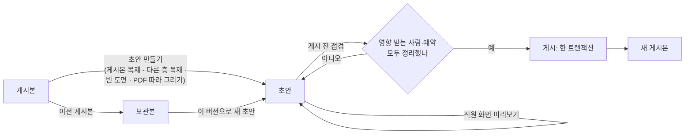
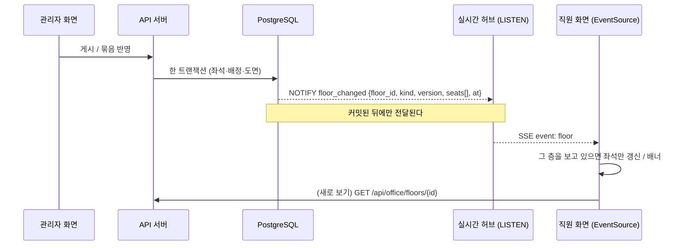
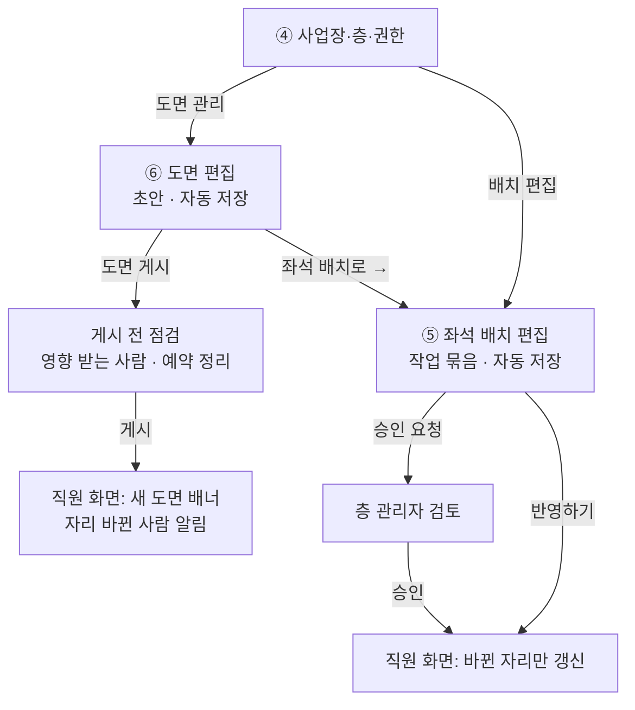

# 도면 편집 · 좌석 배치 편집 설계 (초안 v0.1)

관리자 페이지의 두 핵심 기능, **⑥ 도면 편집**과 **⑤ 좌석 배치 편집**을 어떻게 만들지 정리한 문서입니다.
디자인 시안(Claude Design의 Admin·FloorEditor 화면)과 지금 DB 구조(`db/schema/03_space.sql`, `04_seating.sql`)를
바탕으로 했고, 아래 네 질문에 답하는 것을 목표로 합니다.

1. 도면을 고치면, 이미 앉아 있던 사람들은 어떻게 되나
2. 입주 부서·팀(팀 구역)은 어떻게 만들고 고치고 없애나
3. 고친 도면·배치를 보고 있는 직원 화면에는 어떻게 보여 주나
4. 도면과 배치는 어디에 어떻게 저장해서 오래 유지하나

맨 끝 [정해 주셔야 할 것](#11-정해-주셔야-할-것)에 결정이 필요한 항목을 모았습니다.

---

## 0. 한눈에

| | ⑥ 도면 편집 | ⑤ 좌석 배치 편집 |
|---|---|---|
| 무엇을 고치나 | 벽·기둥·공간(회의실 등)·책상 묶음 | 누가 어느 자리에 앉나, 팀 구역, 좌석 유형 |
| 얼마나 자주 | 드묾 (이사·리모델링) | 잦음 (입사·퇴사·조직 개편) |
| 저장 단위 | **초안 → 게시** (도면 버전) | **작업 묶음** (여러 변경을 모아 한 번에 반영) |
| 직원 화면 반영 | 게시하는 순간 한 번에 | 묶음을 반영(또는 승인)하는 순간, 바뀐 자리만 |
| 누가 | 사업장 관리자 이상 | 층 관리자(층 전체), 구역 관리자(내 구역, 즉시 또는 승인 후) |

핵심 원칙 다섯 가지:

1. **좌석은 도면 버전이 아니라 층에 붙은, 오래 가는 행이다.** 도면의 책상 칸마다 고유 ID가 있고
   (`seats.plan_element_key`), 그 ID로 좌석과 연결한다. 그래서 도면을 새 버전으로 고쳐도 같은 책상이면 같은 좌석,
   같은 배정이 그대로 이어진다. (지금 스키마가 이미 이렇게 되어 있다.)
2. **게시할 때 "영향 받는 사람"을 반드시 정리한다.** 자리가 없어지는 사람은 새 자리 또는 "미배치"로 정해야 게시된다.
   아무도 모르게 자리를 잃는 사람이 없다.
3. **팀 구역의 원본은 "좌석 묶음"이다.** 구역 모양은 그 좌석들을 감싸서 자동으로 그린다. 책상이 움직여도 구역이 따라간다.
4. **직원 화면은 바뀐 만큼만, 방해되지 않게 바뀐다.** 자리 배정은 그 자리만 바로(재실 상태처럼), 도면 게시는
   "새 도면이 게시됐어요 · 새로 보기" 배너. 내 자리가 바뀐 사람에게는 따로 알린다.
5. **한 번에, 되돌릴 수 있게 저장한다.** 게시·반영은 한 DB 트랜잭션, 도면은 버전마다 통째로 보관, 배정은 끝내고 새로
   만드는 이력 방식. 언제든 "이 버전으로 되돌리기"가 된다.

---

## 1. 용어

| 용어 | 뜻 |
|---|---|
| 도면 (floor plan) | 한 층의 그림. 버전이 있다: 초안(DRAFT, 층마다 1개), 게시본(PUBLISHED, 1개), 보관본(ARCHIVED, 여러 개) |
| 요소 (element) | 도면을 이루는 것: 벽, 기둥, 문, 창, 계단·EV, 공간(사무·회의실·탕비·화장실·임원실·출입 불가), 책상 묶음, 가구, 라벨 |
| 책상 묶음 · 칸 | "마주보기 2×3" 같은 책상 덩어리. 칸마다 책상 또는 빈칸. **책상 칸 1개 = 좌석 1석** (디자인: "책상 = 좌석") |
| 좌석 (seat) | 직원이 배정받는 자리. 고정석 / 팀 내 자율석 / 사용 중지 |
| 팀 구역 (zone) | 한 팀(부서)이 쓰는 좌석 묶음 + 색. 공용 자율석 구역은 부서 없음 |
| 배정 (assignment) | 누가 어느 좌석에 언제부터 언제까지 앉나 |
| 미배치 인원 | 팀원인데 지금 자리가 없는 사람 (신규 입사, 복귀, 도면 변경으로 자리가 없어진 사람) |
| 작업 묶음 (change set) | 배치 화면에서 한 변경들을 모은 것. 자동 저장되고, 한 번에 반영하거나 승인 요청한다 (`change_requests`) |

---

## 2. 데이터 모델

### 2.1 지금 있는 것과 바꿀 것

| 테이블 | 지금 | 바꾸거나 더할 것 |
|---|---|---|
| `floor_plans` | 층별 버전, DRAFT/PUBLISHED/ARCHIVED, `geometry` JSONB, 배경 파일, 층당 게시본 1·초안 1 (부분 유니크 인덱스) | `base_plan_id`(초안이 어느 게시본에서 시작했나), `revision`(자동 저장마다 +1, 동시 수정 막기), `editing_by`·`editing_heartbeat_at`(편집 중 표시), `publish_note`, `scheduled_publish_at`(4단계) |
| `seats` | 층에 붙음, `plan_element_key`(책상 칸 ID), `zone_id`, 좌표(비율), `status`에 REMOVED | `removed_at`, `removed_by_plan_id`(어느 게시로 빠졌나) |
| `zones` | 층별 구역, 부서, 색, `shape` | `shape`는 **좌석에서 자동 계산한 캐시**로 바꾼다 (`shape_mode`: AUTO/MANUAL). `name`은 기본이 부서 이름(별칭 허용) |
| `meeting_rooms` | `plan_element_key`(공간 ID), `shape` | 게시할 때 도면의 회의실 공간과 맞춘다 |
| `seat_assignments` | 기간 있는 배정 이력, 좌석·사람 겹침 금지(EXCLUDE) | `source`(MANUAL / CHANGE_SET / PLAN_PUBLISH / ORG_SYNC), `change_request_id`는 이미 있음 |
| `change_requests` · `_items` | 구역 관리자 요청(DRAFT/PENDING/APPROVED/REJECTED), 항목 ASSIGN/UNASSIGN/MOVE_ZONE | 층 관리자의 작업 묶음도 같은 테이블에 (바로 반영하면 스스로 APPROVED). 항목에 `SWAP`, `SET_SEAT_TYPE`, `expected_employee_id`(만들 때의 상태, 충돌 감지), 묶음에 `effective_at`(언제부터, 4단계) |
| `audit_logs` | 있음 | PLAN_PUBLISH, CHANGE_SET_APPLY, ZONE_* 기록 |
| `notifications` | 있음 (IN_APP) | SEAT_CHANGED(내 자리 바뀜), PLAN_PUBLISHED(관리자) |

새 테이블은 만들지 않는 것을 목표로 한다. 필요한 칸을 더하는 정도로 끝난다.

### 2.2 도면 geometry (JSON v1)

지금 게시본은 `{walls, pillars, spaces}`를 비율(0~1) 좌표로 갖고 있다. 편집기는 **미터 단위** v1을 쓴다
(격자 0.5 m, 축척 맞춤이 쉬움). 직원 화면 API는 지금처럼 비율로 바꿔서 내보낸다. 읽을 때 `schema` 번호를 보고 변환한다.

```json
{
  "schema": 1,
  "grid_m": 0.5,
  "elements": [
    { "id": "w-01", "type": "wall", "points": [[1.0, 1.5], [49.0, 1.5]], "thickness_m": 0.3 },
    { "id": "p-01", "type": "pillar", "x": 13.1, "y": 9.8, "w": 0.6, "h": 0.6 },
    { "id": "sp-07", "type": "space", "kind": "meeting", "rect": [1.2, 1.8, 9.0, 8.4],
      "label": "대회의실 701", "room": { "capacity": 12, "equipment": ["VIDEO"] } },
    { "id": "dg-02", "type": "desk_group", "layout": "face_to_face", "rows": 2, "cols": 3,
      "origin": [26.0, 13.5], "rotation": 0,
      "cells": [
        { "id": "dg-02.c1", "kind": "desk", "code": "B-01" },
        { "id": "dg-02.c2", "kind": "desk", "code": "B-02" },
        { "id": "dg-02.c3", "kind": "blank", "note": "기둥" }
      ] },
    { "id": "lb-03", "type": "label", "x": 30.0, "y": 20.0, "text": "휴게 공간" }
  ]
}
```

- 요소 `id`는 편집기가 만들 때 한 번 정하고 바뀌지 않는다. 복사하면 새 ID.
- 책상 칸 → 좌석 (`seats.plan_element_key = cell.id`), 회의실 공간 → 회의실 (`meeting_rooms.plan_element_key = space.id`).
- **팀 구역은 도면에 넣지 않는다.** 디자인에서도 레이어 "팀 구역 · 배치 화면에서"로 되어 있다. 구역은 좌석 배치 화면 몫이다.
- 크기: 한 층 요소 수백 개, 수십~수백 KB. 자동 저장 때 통째로 저장해도 충분하다.

### 2.3 도면과 행을 맞추는 규칙 (게시할 때)

```
게시본 도면의 책상 칸  ─┐                      ┌─ seats (살아 있는 좌석)
                       ├─ cell.id = plan_element_key ─┤
초안 도면의 책상 칸   ─┘                      └─ seat_assignments (누가 앉았나)
```

| 초안에서 | 좌석 | 앉아 있던 사람 |
|---|---|---|
| 같은 칸, 위치·방향만 바뀜 | 같은 좌석, 좌표·방향만 갱신 | 그대로 |
| 같은 칸, 좌석 번호만 바뀜 (B-03 → B-05) | 번호 갱신 | 그대로, "좌석 번호가 바뀌었어요" 알림 |
| 새 책상 칸 | 새 좌석 (빈 자리) | — |
| 책상 칸이 없어짐 (지움, 빈칸으로 바꿈) | `REMOVED` (지우지 않음) | **정리 필요** (3.2) |
| 책상 묶음을 지우고 새로 그림 (ID가 바뀜) | 옛 좌석 REMOVED + 새 좌석 | 게시 전 점검에서 "같은 자리로 이어 붙이기" 추천 (번호가 같거나 위치가 가까운 새 칸) |
| 회의실 공간이 없어짐 | 회의실 비활성 | 앞으로 잡힌 예약 **정리 필요** (3.2) |

---

## 3. 도면 편집 (⑥)

### 3.1 초안의 일생



- **만들기**: 디자인의 "새 층 시작 방법" 그대로. 기본은 지금 게시본을 복제해서 고친다. PDF·이미지는 배경으로 깔고 따라 그린다
  (`background_file_id`, 투명도).
- **자동 저장**: 고치고 2초 쉬면 저장. 요청에 `revision`을 같이 보내고, 서버의 값과 다르면(다른 탭·다른 사람이 먼저 저장)
  409로 막고 "다른 곳에서 고쳤어요 · 다시 불러오기"를 띄운다. 헤더에 "초안 · 2분 전 자동 저장 · 게시 전까지 직원 화면에
  반영되지 않음"(디자인 문구).
- **동시 편집**: 한 층 초안은 한 사람이 편집한다. 편집 화면이 30초마다 heartbeat를 보내고, 다른 관리자가 열면
  "강지아 차장이 편집 중 (1분 전)" + 보기만. 2분 넘게 heartbeat가 없으면 풀리고, 상위 관리자는 "편집 넘겨받기".
- **되돌리기·다시하기**: 편집 화면 안에서 명령 단위로 (서버는 자동 저장 스냅샷만 안다).
- **미리보기**: 초안 도면 + 지금 배정으로 직원 화면 모양을 그대로 보여 준다.
- **보관본으로 되돌리기**: 보관본에서 새 초안을 만들어 게시한다. 게시 전 점검을 똑같이 거친다(그사이 배정이 바뀌었을 수 있다).

### 3.2 게시 전 점검: 기존 배치 인원은 어떻게 하나 (질문 1)

"도면 게시"를 누르면 바로 게시하지 않고, 초안과 지금 상태를 비교한 **점검 화면**을 먼저 띄운다.

```
7F 도면 게시 전 확인
────────────────────────────────────────────
✓ 좌석 46석 → 48석 (새 좌석 4, 없어지는 좌석 2, 번호 바뀜 3)
! 자리가 없어지는 사람 2명                         [모두 추천대로]
   조시우 대리 (재무팀)  B-04 →  [B-11 (같은 구역 빈 자리) ▾]   [직접 고르기] [미배치로]
   오서연 과장 (재무팀)  B-05 →  [미배치]                      ...
! 예약이 있는 회의실이 없어짐 1곳
   소회의실 702 · 앞으로 예약 3건 → [회의실 703으로 옮기기 ▾] [취소하고 알리기]
· 구역 밖으로 나간 좌석 1석 (D-07: 재무팀 구역 → 구역 없음)   [배치 화면에서 정리]
────────────────────────────────────────────
게시 메모: [7F 리모델링 1차]            반영: (•) 지금  ( ) 날짜 지정
                                   [취소]  [게시하기]  ← 빨간 항목을 모두 정해야 켜짐
```

- **자리가 없어지는 사람**마다 셋 중 하나를 고른다.
  1. **추천 자리로 옮기기**: 같은 구역의 빈 고정석 → 같은 번호의 새 좌석 → 가장 가까운 빈 자리 순으로 자동 추천.
     "모두 추천대로"로 한 번에.
  2. **직접 고르기**: 초안 도면 위에서 고른다.
  3. **미배치로**: 그 팀의 "미배치 인원" 목록으로 간다. 나중에 좌석 배치 화면에서 배정한다.
- **오늘 자율석을 쓰는 사람**(DAILY)의 좌석이 없어지면 그 사용을 끝내고 알린다.
- **회의실이 없어지거나 정원이 줄어드는데 앞으로 예약이 있으면** 다른 회의실로 옮기거나(같은 시간 빈 곳 추천)
  취소하고 참석자에게 알린다.
- 빨간 항목을 모두 정해야 게시 버튼이 켜진다. 아무도 모르게 자리를 잃는 사람은 생기지 않는다.

**게시는 한 트랜잭션**으로 처리한다. 중간에 실패하면 전부 취소된다.

1. 이 층 게시본·초안 행을 잠근다 (`SELECT … FOR UPDATE`). 초안의 `base_plan_id`가 지금 게시본이 아니면
   (그사이 다른 게시가 있었으면) 멈추고 점검을 다시 하게 한다.
2. 이전 게시본 → ARCHIVED, 초안 → PUBLISHED (`published_by/at`, 메모).
3. 좌석 맞추기 (2.3 표): 좌표·번호 갱신, 새 좌석 INSERT, 없어진 좌석 REMOVED.
4. 점검에서 정한 대로 배정 옮기기: 옛 배정 `ends_at = now()`, 새 배정 INSERT (`source = PLAN_PUBLISH`).
   미배치로 정한 사람은 끝내기만. 좌석·사람 겹침은 DB 제약(EXCLUDE)이 마지막으로 막는다.
5. 회의실 맞추기, 예약 옮기기·취소.
6. 구역 모양 다시 계산 (좌석이 움직였으니).
7. `audit_logs`(바뀐 좌석·사람 요약), `notifications`(자리 바뀐 사람에게), `NOTIFY floor_changed`.

### 3.3 권한

| | 전사 | 사업장 | 층 | 구역 |
|---|---|---|---|---|
| 도면 초안 편집·게시 | ○ | ○ (그 사업장) | ✕ (보기만) | ✕ |
| 보관본 되돌리기 | ○ | ○ | ✕ | ✕ |

지금 권한표("사업장 관리자: 도면 편집")를 따른 안이다. 좌석 배치 시안에서 "좌석 추가 · 도면 수정"이 "층 관리자 이상"으로
되어 있어서, 층 관리자에게 어디까지 열지는 [결정 1](#11-정해-주셔야-할-것)로 남긴다.

---

## 4. 좌석 배치 편집 (⑤)

### 4.1 도구 (디자인 그대로)

- **선택·이동**: 사람을 끌어서 다른 빈 좌석에 놓기. 미배치 인원 목록에서 끌어다 놓기.
- **자리 교환**: 두 사람 자리 바꾸기.
- **배정 해제**: 자리를 비우고 그 사람을 미배치로.
- **좌석 유형**: 고정석 / 팀 내 자율석 / 사용 중지(고장·수리).
- **팀 구역 지정**(층 관리자 이상): 5장.
- **미배치 인원 패널**: 조직도 기준 우리 팀원 중 지금 자리가 없는 사람. 신규 입사·복귀·도면 변경으로 밀려난 사람이 여기 쌓인다.
- **직원 화면 미리보기**, **되돌리기**.
- 구역 관리자는 내 구역 좌석과 우리 팀원만 움직인다. 잠긴 구역에 놓으면
  "다른 구역 · 층 관리자에게 요청" 안내 (디자인 문구), "구역 확장 요청"으로 이어진다.

### 4.2 저장: 작업 묶음

끌어다 놓을 때마다 바로 직원 화면에 반영하지 않고, **작업 묶음**에 쌓았다가 한 번에 반영한다.

- 왜: 재배치 중에는 "두 사람이 한 자리"나 "아무 데도 없는 사람" 같은 중간 상태가 생긴다. 이걸 직원들이 실시간으로
  보면 혼란스럽다. 묶음이면 되돌리기도 쉽고, 승인도 묶음 단위로 한다.
- 화면을 열면 내 "작성 중" 묶음(`change_requests.status = DRAFT`)을 이어서 쓴다. 변경 하나 = 항목 하나
  (`ASSIGN / UNASSIGN / SWAP / MOVE_ZONE / SET_SEAT_TYPE`). 자동 저장. 헤더에 "미반영 변경 2건 · 자동 저장됨".
- **반영**
  - 층 관리자 이상, 또는 "즉시 반영" 구역 관리자: **[반영하기]** → 한 트랜잭션으로 적용, 묶음은 스스로 APPROVED.
  - "층 관리자 승인 후" 구역 관리자: **[층 관리자에게 승인 요청]** → PENDING. 층 관리자는 전후 비교(직원 화면
    미리보기)를 보고 승인(적용) 또는 반려(사유).
- **충돌**: 항목마다 만들 때의 상태(`expected_employee_id`: 그 좌석에 원래 누가 있었나)를 기억한다.
  적용할 때 지금 상태와 다르면(그사이 다른 관리자가 바꿈) 그 항목만 "충돌"로 표시하고 나머지는 그대로 둔 채 다시 고르게 한다.
- **규칙**: 한 사람 고정석 1개, 한 좌석 1명 (DB 제약 EXCLUDE가 이미 있음). 퇴사자는 넣을 수 없다.
- **반영 시점**(4단계): 묶음에 "11/1(월)부터"처럼 날짜를 정하면 배정의 `starts_at`을 그날로 넣는다.
  직원 화면은 이미 `starts_at <= now()`인 배정만 보여 주므로 그날이 되면 저절로 바뀐다.

### 4.3 이력

배정은 지우지 않고 끝내고 새로 만들어서(`seat_assignments`) "이 자리에 누가 앉았었나", "이 사람 자리 이력"을 볼 수 있다.
묶음·게시는 `audit_logs`에 남는다. 묶음 되돌리기는 거꾸로 하는 새 묶음을 만들어 반영한다.

---

## 5. 입주 부서·팀 관리 (질문 2)

### 5.1 구역의 원본은 "좌석 묶음"

- 구역 = 좌석들의 `zone_id` + 부서 + 코드(A, B, …) + 색(t1~t4, 공용 t0).
- 화면에 보이는 색 영역(`zones.shape`)은 **그 구역 좌석들을 감싸서 자동으로 계산**한다 (책상 묶음별 사각형을 합친 모양).
  필요하면 관리자가 손으로 다듬을 수 있다(MANUAL).
- 그래서 **도면을 고쳐 책상이 움직여도 구역이 따라간다.** 도면과 구역이 따로 놀아서 "구역 밖 좌석"이 생기는 일이 줄어든다.
  (지금처럼 사각형을 따로 저장하면, 책상만 옮겼을 때 구역 사각형이 엉뚱한 곳에 남는다.)

### 5.2 추가 · 수정 · 삭제

| 하고 싶은 것 | 어떻게 | 앉아 있는 사람 |
|---|---|---|
| 팀 구역 추가 | 배치 화면 "팀 구역 지정" → 부서 고르기(조직도, 공용이면 없음) → 코드·색(층 안에서 겹치지 않게 자동 추천) → 좌석을 끌어서 묶기 | 영향 없음 |
| 경계 바꾸기 (좌석 더하기·빼기) | 좌석을 다른 구역으로 옮기기 (`MOVE_ZONE` 항목). 구역 관리자는 "구역 확장 요청" | 그대로 앉아 있고, 다른 팀 구역에 앉게 되면 표시 |
| 부서·이름·색 바꾸기 | 구역 속성. 팀 이름 변경은 조직도 동기화로 저절로 | 영향 없음 |
| 구역 없애기 (팀이 이 층에서 나감) | 점검 화면: "재무팀 구역 18석 · 앉아 있는 16명" → 사람마다 [다른 층 새 구역으로] [미배치로] [그 자리 유지(구역 없음)] | 정리 필요 |
| 팀 이사 (7F → 5F) | 4단계 "구역 옮기기" 도우미: 새 층에 구역 만들기 → 사람들을 새 자리에 일괄 대응(순서대로·직접) → 날짜 지정 반영 → 옛 구역 정리 | 날짜에 맞춰 한 번에 이동 |

- 구역 관리자 권한(`admin_grants`의 ZONE_ADMIN)은 구역에 붙어 있다. 구역을 없애면 권한도 회수하고 당사자에게 알린다.
- 층 버튼·사업장 화면의 "입주 팀"은 구역에서 저절로 나온다 (지금도 그렇다).

### 5.3 조직도 동기화와의 관계

조직도(엑셀·인사 API)를 다시 가져올 때(`org_sync_runs`) 자리·구역은 이렇게 따라간다.

| 조직도 변화 | 자리·구역 |
|---|---|
| 부서 이름 변경 | 구역 이름이 따라 바뀜 (별칭을 정했으면 유지) |
| 부서 폐지 (`is_active = false`) | 구역은 남기고 "폐지된 부서의 구역" 경고, 층 관리자에게 알림 |
| 직원 부서 이동 | 자리는 유지하되 "다른 팀 구역에 앉은 사람"으로 표시, 새 팀의 미배치 목록에도 뜸 ([결정 6](#11-정해-주셔야-할-것)) |
| 퇴사 | 배정을 퇴사일로 끝내 자리를 비움, 그 팀 구역 관리자에게 알림 |
| 신규 입사 | 그 팀 "미배치 인원"에 뜸 |

---

## 6. 직원 화면 실시간 반영 (질문 3)

### 6.1 무엇을 보낼까

| 일 | 이벤트 | 그 층을 보고 있는 직원 화면 | 다른 층을 보는 직원 |
|---|---|---|---|
| 배치 묶음 반영 | `seats_changed` (바뀐 좌석 목록) | 그 자리들만 바로 바꿈 (재실 상태처럼, 확대·선택 유지) + 짧게 "7F 자리 배치가 바뀌었어요 (3석)" | 없음 |
| 도면 게시 | `plan_published` (층, 버전) | 배너 **"7F 도면이 새로 게시됐어요 · 새로 보기"**. 1분 동안 아무 조작이 없으면 저절로 새로 읽음 | 층 버튼에 작은 점 |
| 구역 바뀜 | `zones_changed` | 구역 색·이름만 바로 다시 읽음 | 없음 |
| 내 자리 바뀜 | `my_seat_changed` (그 사람에게만) | 어느 화면이든 "내 자리가 7F B-04 → B-11로 바뀌었어요" + 알림 저장 (메신저 연동 후 메신저) | 같음 |

도면 게시를 바로 바꾸지 않고 배너로 묻는 이유: 보던 확대·자리 선택·검색 결과가 갑자기 바뀌면 혼란스럽다.
배치 변경은 작고 국소적이어서 바로 바꿔도 된다.

### 6.2 어떻게 보낼까

지금 재실 상태가 쓰는 길을 그대로 넓힌다.



- 트리거·`pg_notify`로 보내서, API를 거치지 않은 변경(일괄 작업·SQL)도 똑같이 알린다. NOTIFY는 커밋된 뒤에만
  전달되므로 반쯤 반영된 상태가 화면에 가지 않는다.
- 지금 `PresenceHub`를 채널 여러 개를 듣는 `RealtimeHub`로 일반화하고, `/api/presence/stream` 하나에 `presence`·`floor`
  이벤트를 같이 보낸다 (연결 하나로 충분).
- 놓친 이벤트: 다시 연결되면 지금처럼 `resync`로 전체를 다시 읽는다. 화면은 받아 둔 도면 버전을 기억하고, 다르면 배너를 띄운다.
- 날짜 지정 반영(4단계): 층 응답에 `next_change_at`(다음에 바뀌는 시각)을 넣으면 화면이 그 시각에 다시 읽는다
  (재실 상태 자동 해제와 같은 방식). 알림은 간단한 주기 작업이 그 시각에 보낸다.
- 관리자끼리: 배치 화면도 같은 이벤트를 받아서, 다른 관리자가 반영한 좌석이 내 묶음과 겹치면 바로 "충돌" 표시.

---

## 7. 저장과 영속성 (질문 4)

### 7.1 무엇을 어디에

모두 지금 쓰는 PostgreSQL 하나에 둔다 (원본 파일만 디스크·NAS).

| 무엇 | 어디 | 형태 | 보관 |
|---|---|---|---|
| 도면 그림 (벽·공간·책상 묶음·라벨) | `floor_plans.geometry` | JSONB, 버전마다 통째로 | 초안 1 + 게시본 1 + 보관본 전부 |
| 좌석 | `seats` | 행. 책상 칸 ID로 도면과 연결 | 지우지 않고 REMOVED |
| 회의실 | `meeting_rooms` | 행. 공간 ID로 연결 | 비활성 |
| 팀 구역 | `zones` + `seats.zone_id` | 행 | 비활성 |
| 배정 | `seat_assignments` | 기간 있는 이력 행 | 전부 |
| 작업 묶음·승인 | `change_requests`, `_items` | 행 | 전부 |
| 평면도 원본 (PDF·이미지) | `files` + 파일 저장소 | 파일 | 버전마다 참조 |
| 누가 무엇을 | `audit_logs` | 전후 JSON | 전부 (보관 기간은 결정 7) |

### 7.2 깨지지 않게

- **DB 제약이 마지막 방어선**: 좌석 겹침·사람 겹침(EXCLUDE), 층당 게시본 1·초안 1(부분 유니크), 층 안 좌석 번호 유일.
- **게시·묶음 반영은 한 트랜잭션.** 실패하면 아무것도 바뀌지 않는다.
- **자동 저장은 `revision` 비교**(낙관적 잠금)로 덮어쓰기를 막는다. 게시는 `base_plan_id`로 그사이 다른 게시가 없었는지 본다.
- **스키마 진화**: `geometry.schema` 번호를 보고 읽을 때 변환한다. 지금 게시본(v0, 비율 좌표)도 계속 읽힌다.
- **백업**: 운영에서는 매일 `pg_dump` + WAL 보관, 파일 저장소 백업. 도면·좌석·배정이 한 DB라 같이 복원된다.
- **되돌리기**: 도면은 보관본 → 새 초안 → 게시. 배치는 거꾸로 하는 묶음.
- **내보내기**: PNG·PDF(디자인의 "내보내기"), 도면 JSON(다른 층 복제·백업).

---

## 8. API 초안

| 요청 | 하는 일 |
|---|---|
| `GET /api/admin/floors/{id}/plan` | 게시본·초안·보관본 목록, 편집 중인 사람 |
| `POST /api/admin/floors/{id}/plan/draft` | 초안 만들기 `{from: "published" \| plan_id \| floor_id \| "blank"}` |
| `PUT /api/admin/plans/{id}` | 자동 저장 `{revision, geometry, background…}` → 새 revision, 다르면 409 |
| `POST /api/admin/plans/{id}/heartbeat` | 편집 중 표시 유지 / 넘겨받기 |
| `GET /api/admin/plans/{id}/publish-check` | 게시 전 점검: 좌석 비교, 영향 받는 사람·예약, 추천 자리 |
| `POST /api/admin/plans/{id}/publish` | 게시 `{resolutions: [{employee, to_seat \| "UNASSIGN"}], rooms: […], note, base_plan_id}` |
| `POST /api/admin/plans/{id}/restore` | 보관본으로 새 초안 |
| `GET /api/admin/floors/{id}/seating` | 배치 화면: 좌석·배정·구역·미배치 인원·내 작성 중 묶음·권한 |
| `PUT /api/admin/change-sets/{id}` | 묶음 자동 저장 (항목 목록) |
| `POST /api/admin/change-sets/{id}/apply` | 반영 (권한 있으면). 충돌 항목은 409와 함께 목록 |
| `POST /api/admin/change-sets/{id}/submit` · `approve` · `reject` | 승인 흐름 |
| `POST /api/admin/floors/{id}/zones` · `PATCH`/`DELETE /api/admin/zones/{id}` | 구역 (삭제는 점검 후) |
| SSE `event: floor` | `{floor_id, kind: seats\|plan\|zones, version, seats?: […], at}` |

---

## 9. 화면 흐름



---

## 10. 단계별로 만들기

자주 쓰는 것부터, 위험한 것은 점검 장치와 함께.

| 단계 | 내용 | 이유 |
|---|---|---|
| **1. 좌석 배치 편집** | 배치 화면(⑤): 미배치 인원, 끌어서 배정·교환·해제, 좌석 유형, 작업 묶음 자동 저장, 즉시 반영 / 승인 요청·승인, 충돌 표시, 실시간 좌석 갱신, "내 자리 바뀜" 알림, 이력 | 가장 자주 쓰고, 도면을 안 고쳐도 바로 가치가 있다 |
| **2. 팀 구역 관리** | 구역 지정(좌석 묶기), 자동 모양, 부서·색, 구역 확장 요청, 구역 삭제 점검, 조직도 동기화 경고 | 1단계 배치 화면 위에 얹는다 |
| **3. 도면 편집기** | 초안·자동 저장·편집 잠금, 구조·공간·책상 묶음 도구, 배경 PDF, 게시 전 점검, 게시·배너, 보관본 되돌리기 | 가장 크고 위험. 1·2단계의 배정·알림 장치를 그대로 쓴다 |
| **4. 일정과 이사** | 날짜 지정 반영(묶음·게시), 팀 이사 도우미, 내보내기(PNG·PDF), 다른 층 복제·템플릿 | 운영하면서 필요해지는 것 |

각 단계는 데모 데이터(지금 목업)로 끝까지 써 볼 수 있게 만들고, 실시간 반영·충돌·권한을 브라우저 테스트로 확인한다.

---

## 11. 정해 주셔야 할 것

| # | 질문 | 제안 |
|---|---|---|
| 1 | 층 관리자에게 도면 편집을 열까? (시안의 배치 화면은 "좌석 추가 · 도면 수정 = 층 관리자 이상") | 도면 게시는 사업장 관리자 이상. 층 관리자는 배치 화면에서 "책상 묶음의 빈칸 ↔ 책상" 정도만 → 도면 초안에 쌓이고 사업장 관리자가 게시 |
| 2 | 게시로 자리가 없어진 사람의 기본값 | "추천 자리"를 기본으로 채워 두고, 관리자가 확인 후 게시 (미배치는 직접 고를 때만) |
| 3 | 도면 게시 때 직원 화면 | 배너 + 1분 동안 조작이 없으면 저절로 새로 읽기 |
| 4 | 날짜 지정 반영(이사 날짜)을 언제 넣을까 | 4단계. 1단계는 "지금 반영"만 |
| 5 | 구역 관리자의 기본 반영 방식 | 지금처럼 층마다 선택 (기본: 층 관리자 승인 후) |
| 6 | 직원이 다른 팀으로 옮기면 자리는? | 자리 유지 + "다른 팀 구역에 앉은 사람" 표시, 두 팀 관리자에게 알림 (자동 해제는 하지 않음) |
| 7 | 보관본·이력 보관 기간 | 도면 보관본 전부, 배정 이력·감사 기록 5년 (사내 규정에 맞춰 조정) |
| 8 | 첫 도면은 어떻게 만들까 (실제 7F 평면도) | PDF를 배경으로 깔고 따라 그리기. 현장 실측 축척(1:100)을 처음 한 번 맞춘다 |
